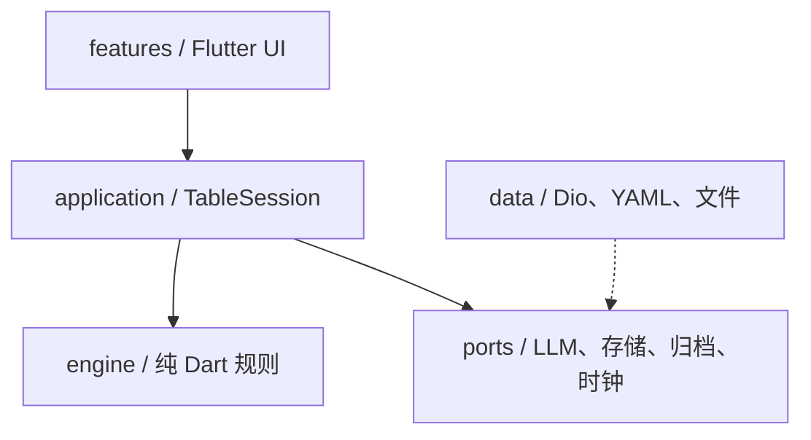

> **一个人也能愉快地进行跑团。**
>
> Flutter · Dart · LLM · 个人项目
>
> [GitHub](https://github.com/hzdDylan/ai_paotuan_roundtablemetting) · [PRD](PRD/README.md) · [SE](SE/SE_软件设计说明.md)

## 最精简介绍

> 我做了一个 Flutter AI 跑团应用，只需要一个人并接入API就可以执行。
>
> 市面上很多 AI 跑团只有“1 个真人 + AI GM”，我想让 AI 队友也有自己的目标，会吐槽、会拒绝、会改口。
>
> 技术上，规则和骰子放在纯 Dart 引擎里，LLM 只负责演；用知识边界控制每个角色能看到什么；用端口和 Fake 实现让 AI 应用也能写测试。当前 146 个测试全部通过，CI 跑 format、analyze、分层检查和测试。
>
> 它最能体现的是：把 AI 能力产品化、工程化的能力，而不只是做一个聊天 Demo。

## 项目是什么

单机 AI 跑团 App：**1 名真人 + 多名 AI 玩家（BP）+ AI 守秘人（KP）**。

玩家选剧本、制卡、上桌；AI 队友会按自己的目标说话、吐槽、拒绝、改口；需要判定时本地掷 d100，KP 按骰值叙述；场景有时钟、线索、出口，结束后自动归档。

> 注意不是“AI 聊天套壳”，而是把多智能体调度、跑团规则、知识边界、内容安全串成完整游戏循环。

## 一局怎么跑

```text
选剧本 → 制卡 → 上桌 → 玩家行动 → AI 队友/KP 回应
→ d100 检定 → 场景推进 → 结局 → 自动归档
```

4 个内置剧本：顾先生的晚宴、雾码头、百乐门最后一支舞、霞飞路 47 号。

## 核心亮点

| 亮点 | 说明 |
|---|---|
| AI 是玩家，不是助手 | 多个 BP 有目标、秘密、语气，会互相接话；Director 决定谁开口 |
| 规则优先 | 骰子、难度、成败全部本地计算，LLM 不能改结果 |
| 知识边界 | 事件分 public / kpOnly / party / private，拼 Prompt 前过滤 |
| 多检定统一叙述 | 一次行动可触发多个检定，合并成一段后果，避免节奏断裂 |
| 本地优先 | BYOK、事件流 NDJSON、归档在本机 |
| 剧本数据化 | YAML 描述角色/场景/时钟/线索/出口，新增剧本不改引擎 |

## 技术架构



- `engine/`：纯 Dart，不依赖 Flutter / `dart:io` / `dio` / `yaml`
- `application/`：`TableSession` 编排开局、提交、检定、场景、归档
- `data/`：LLM、YAML、事件存储、归档等适配器
- `features/`：页面与组件，通过 Riverpod 读写状态
- 所有外部能力通过端口 + Provider 注入，测试可替换为 Fake

## 技术难点

1. **LLM 不确定 vs 规则确定**：模型只负责演，掷骰和成败在本地。
2. **多角色上下文**：按 Viewer 过滤事件，避免 BP 看到 KP 秘密。
3. **多智能体节奏**：Director + 发言冲动 + 场景状态，避免抢话/冷场。
4. **可测试性**：Fake LLM、固定随机源、固定时钟，AI 应用也能回归测试。

## 工程数据

| 项 | 现状 |
|---|---|
| 测试 | 146 个，全部通过 |
| 静态检查 | `flutter analyze` 0 issue |
| CI | format + analyze + 分层检查 + test |
| 平台 | Android / OHOS 为主（因为我只有两个系统的手机） |

## 竞争点

- **对比 AI Dungeon / Character.AI**：它们偏自由聊天；本项目有骰子、场景、时钟、出口、失败和归档。
- **对比 SillyTavern**：它是角色扮演前端；本项目有游戏引擎和多智能体编排。
- **对比 Roll20 / Fantasy Grounds**：它们需要真人组队；本项目一个人就能开团。

真正的壁垒不是模型，而是**编排、规则、知识边界、内容管线**。

## 局限

个人项目，因为证书等原因，不会做线上和商业化。
