# 一人成团（Party of AIs）· SE 软件设计说明

| 项 | 内容 |
|---|---|
| 版本 | v0.5（28 项决策全部落定） |
| 日期 | 2026-10-21 |
| 依据 | [PRD v0.2](../PRD/README.md)（01–06） |
| 平台 | Android（主）+ HarmonyOS / OHOS（并行） |
| 形态 | 单机客户端，直连 LLM（BYOK），无自建服务端 |
| 现状 | 28 项决策：**全部已定** |
| 读者 | 你自己（实现者）、GitHub 访客（看设计取舍） |

---

## 0. 怎么读这份文档

### 0.1 本文回答什么

PRD 回答「做什么」，本文回答「怎么实现」：拆成哪些模块、模块怎么通信、数据长什么样、哪一步会失败、失败怎么办、怎么验证。

**不回答**「先做哪个后做哪个」——工程阶段统一放在最末 §13。

### 0.2 约定

| 标记 | 含义 |
|---|---|
| **已定** | 已经拍板的结论，本文只写结论与理由，**不再保留备选方案**（唯一例外：D-07 按你的要求保留备选）。 |
| **现状** | 28 项决策全部落定，正文只写结论与理由；**没有待定项**（D-07 按你的要求保留备选）。 |
| **正文规则** | 不出现任何分期/优先级编号；工程阶段只在最末 §13 声明一次。 |
| **不变量** | 标「不变量」的条目是硬约束，改动必须改本文并升版本号。 |

### 0.3 术语

| 术语 | 定义 |
|---|---|
| **KP** | 守秘人（Keeper）。**就是 PRD 里的 GM**，同一个角色，本文统一叫 KP；不做 GM 配置项。KP 拥有全场视野，可见所有事件（`audience: kp` 也对它开放）。 |
| **BP** | Bot Player，AI 扮演的跑团玩家。 |
| **NPC** | KP 扮演的非玩家角色。 |
| **BEAT** | 最小推进单位：谁说话 → 做什么 → 可能检定 → 结果 → 状态变化。 |
| **SPOTLIGHT** | 当前该谁说话，由 Director 打分决定。 |
| **CHECK / ROLL** | 检定（技能 + 难度 + 目标 + 代价）/ 一次 d100 掷骰记录。 |
| **DIRECTOR** | 决定 spotlight 的规则组件，不参与演出。 |
| **INTERJECT** | 插话：玩家在 BP/NPC 说话时打断。 |
| **ARCHIVE** | 一局结束后的只读记录，只在本机 App 内可读。 |
| **PORT / ADAPTER** | 领域层只声明接口（port），平台能力由适配器实现。 |
| **BUNDLE** | 给某个行动者拼好的 prompt 材料。 |
| **MODERATION** | 玩家输入审核：本地规则先筛，不确定再交 LLM 判。 |

### 0.4 决策台账

| ID | 决策点 | 结论 | 章节 |
|---|---|---|---|
| D-01 | 工程结构 | **B**：`engine` 纯 Dart 包 + Flutter 壳 | §2.7 |
| D-02 | 平台适配 | **A**：条件导入（`conditional import`） | §2.6 |
| D-03 | 编排执行模型 | **A**：纯状态机 + 效果 | §3.1 |
| D-04 | 行动者选择 | **A**：纯规则打分 | §3.2 |
| D-05 | 检定目标来源 | 目标 = **角色技能值**；剧本只给难度与代价 | §3.3 |
| D-06 | 骰子 | **本地随机数** + 先落库 + LLM 无权改 | §3.4 |
| D-07 | 知识边界 | **A**：事件可见性过滤（按要求保留 B/C/D 备选） | §3.5 |
| D-08 | 插话窗口 | **C′**：BP/NPC 说话可打断；**KP 与骰子结算不可** | §3.8 |
| D-09 | 状态管理 | **A**：Riverpod | §4.1 |
| D-10 | 路由 | **A**：`go_router` | §4.1 |
| D-11 | 桌子渲染 | **B + A**：位图打底 + Canvas 动态层 | §4.3 |
| D-12 | 文本呈现 | **D**：按段显示（不做逐字） | §4.4 |
| D-13 | 动效 | **A**：极简（无音效） | §4.5 |
| D-14 | 密钥存储 | **A**：各平台原生安全存储 + `SecretPort` | §4.8 |
| D-15 | LLM 客户端 | **B**：`dio` + 自写 SSE/JSON 处理 | §4.9 |
| D-16 | 供应商 | **A + C**：默认 DeepSeek 预设 + 通用自定义 | §4.9 |
| D-17 | 结构化输出 | **A**：JSON 模式 + Dart 侧校验 | §4.10 |
| D-18 | 上下文策略 | **A**：滑窗截断 | §4.11 |
| D-19 | 剧本格式 | **A**：YAML 随包 | §4.12 |
| D-20 | 剧本分发 | **A**：随包 | §4.12 |
| D-21 | 字体 | **A**：系统字体，不打包 | §8.6 |
| D-22 | 本地存储 | **D**：纯文件（NDJSON + JSON） | §5.6 |
| D-23 | 归档模型 | **A**：全量事件快照 | §5.6 |
| D-24 | 导出 | **D**：**不做导出**（法律/舆情风险） | §4.7 |
| D-25 | 示例归档 | **A**：随包只读 | §4.7 |
| D-26 | 诊断日志 | **A**：只记元数据，不记文本 | §8.3 |
| D-27 | 评估玩家 | **C + B**：预设动作优先，未命中走 LLM | §9.6 |
| D-28 | 玩家输入审核 | **B**：本地规则先筛 + LLM 兜底 | §3.9 |

### 0.5 已确认口径

| ID | 问题 | 结论 |
|---|---|---|
| Q-01 | 桌上人数 | **不含 KP**；= 玩家 + BP + NPC，**2–6 人**，至少 1 玩家 + 1 AI NPC。门廊 = 4/6。 |
| Q-02 | 属性点数 | 8 项**总和 460**（初始各 50 共 400，可分配 60），单项 **15–90**。 |
| Q-03 | SAN | **可损**，初始 = 意志，之后独立下降。 |
| Q-04 / Q-11 | 技能 | **9 项**（神话 0 / 侦查 25 / 聆听 20 / 图书馆 20 / 潜行 20 / 心理学 10 / 妙手 10 / 话术 5 / 闪避 = 敏捷÷2）；技能点 = **智力 × 2**，可分配项 ≤ 70。 |
| Q-05 | 记录内容 | 含骰子日志与插话标记；被中断且已上屏的部分以 `……` 收尾。 |
| Q-06 | beat 控制 | **条数为主、时间为辅**。 |
| Q-07 | 归档删除 | 整包彻底删除，不留摘要。 |
| Q-08 | 年龄门 | 不做启动页、不做年龄确认。 |
| Q-09 | 大成功/大失败 | **两档**：基础技能 ≥ 50 → 大成功 1–5、大失败仅 100；< 50 → 大成功仅 1、大失败 96–100。 |
| Q-10 | 检定目标 | 目标 = **角色技能值**（按难度打折），剧本不写数字。 |

### 0.6 与 PRD 的偏差登记

| # | PRD | 原要求 | 本文处理 | 原因 |
|---|---|---|---|---|
| V-1 | 01 §6 | Android 优先、iOS 后续 | Android + HarmonyOS 并行；iOS 不进验证矩阵 | 你的决定；工具链是 OHOS 分支 |
| V-2 | 02 §4 | 骰子由服务端产生 | 本地随机 + 先落库 + LLM 无权改 | 单机形态 |
| V-3 | 03 §2.5 / 06 §2.3 | 归档可开放、出现在公开列表 | **只做本地历史**，无开放、无公开列表 | 你的决定；无账号无云同步 |
| V-4 | 05 §3.2 | 属性 50 + 40 点，单项 30–80 | 总和 460，单项 15–90 | Q-02 经典点数法 |
| V-5 | 03 F-11 / 05 §3.2 | 4 项技能，初始 20、可分配 40 | **9 项技能** + 经典基础值 + 智力×2 | Q-04 / Q-11 |
| V-6 | 02 §4 | 大成功 01–05、大失败 96–100 固定 | 分两档（≥50 / <50） | Q-09 |
| V-7 | 02 §4 | 服务端真随机 + 校验码 | 本地随机，不做种子承诺/复算 | 你的决定：避免算法干扰 |
| V-8 | 03 F-13 | 上传 1 张图、方形裁剪 | **通用头像**（首字母 + 角色色） | 你的决定：先不做 |
| V-9 | 02 §1 | NPC 不计入队伍人数 | 桌上人数 = 玩家 + BP + NPC（不含 KP） | Q-01 |
| V-10 | 06 §2.5 | 仓库内置示例归档 | 示例**只随包**；App 不读任何外部存档；日志/归档不进仓库 | 你的决定：不依赖 GitHub |
| V-11 | 04 §3 | 场景写死「话术 50 / 侦查 30」 | 剧本只写技能 + 难度 + 代价 | Q-10 |
| V-12 | 05 §4.3 | 逐字显示 | **按段显示**（不做打字机） | 你的决定：避免打断导致半句进上下文 |
| V-13 | 03 F-44 | 可导出 Markdown/JSON | **不做导出** | 你的决定：法律/舆情风险 |
| V-14 | 03 F-29 | 每 beat 自动保存、可继续 | **不做被杀恢复与续局** | 你的决定：先简单跑通 |
| V-15 | 05 §2.2 / §6 | 点击音效、音效开关 | **不做音效** | D-13 选极简 |
| V-16 | 05 §4.4 | 骰子结算时插话可点并排队 | **骰子与 KP 说话时不可打断** | 你的口径（D-08） |
| V-17 | —（PRD 未定义） | — | **新增：玩家输入审核**（本地规则 + LLM 兜底） | 你的要求（D-28） |
| V-18 | [SE D-01](#) | 纯 Dart 内核独立成 `packages/engine` | 实际落在 Flutter 工程内：`lib/engine/`（纯 Dart，不 import flutter）、`lib/app/`、`lib/features/`、`lib/ui/`；测试在 `test/` | 你的要求「代码在 lib 目录里」；代价是 `dart test` 变 `flutter test`，提取成独立包约 1 小时 |
| V-19 | [SE §2.6 平台适配](#) | 三个平台插件在双端都有实现 | **OHOS 上三个插件均无实现**（真机日志确认 `MissingPluginException`）：启动不再等待插件；设置退内存兜底、密钥退沙箱文件（明文）、目录退临时目录 | 真机为 OpenHarmony API 26；`TODO(ohos)`：用 ArkTS MethodChannel 提供 filesDir / 安全存储 / KV，替换兜底 |
| V-20 | [03 F-14 物品](#) | 随身物品 3–5 格 | 先只允许 **2 件**，后续再开放 | 你的决定：先收紧 |
| V-21 | [03 F-40 归档](#) | 「一局结束生成归档」，未说明触发方式 | **只自动归档**：场景结束（KP 返回 end/transition）时自动生成；**不提供任何手动归档入口**，玩家不感知 | 你的决定：不应有人为归档 |
| V-22 | [04 §2.4 BP](#) | 剧本写死 Stella / 老陈 | 每局从**中英混合名字池**随机取不重复的 BP 名，整局保持一致 | 你的要求：避免每局同名疲劳 |
| V-23 | [05 §4.5 建议行动](#) | 建议行动由 UI 预置 | **由当前场景的检定项生成**（技能→措辞），不写死剧本外信息 | 你的要求：修掉「地下室」类剧透选项 |
| V-24 | [SE §4.10 修复调用](#) | 输出不合规时做一次「修复调用」 | **取消一切自动重试与修复调用**：一次请求不合法即停下，界面只给「去设置 / 结束本局」，不再消耗 token | 你的要求：异常时不要重试 |
| V-25 | [SE §4.8 设置](#) | 设置存 `shared_preferences` | **改为 `{dataDir}/settings.json` 落盘**，密钥兜底文件同目录；重启与覆盖安装后可读回 | OHOS 无 shared_preferences 实现；顺带修掉设置不持久 |
| V-26 | [05 §4.2 开局](#) | 开局也走 KP LLM | **剧本提供 `opening` 时直接播固定开场**，不花 token；归档补 `ending.one_line` 与 `last_roll`，记忆回廊卡片/详情可见 | 你的要求：固定开场 + 归档缺最后一拍 |
| V-27 | [SE §3.2 导演](#) | 按冷落拍数轮流 | **改为「发言冲动 P1」**：每个人憋着值 0–10，被点名/情绪事件/憋满 10 才开口，没人过线就回玩家；另加低频 BP 侧聊（每 5 个事件最多 1 次） | 你的要求：要聚会感，不要排班 |
| V-28 | [SE §4.10 KP 输出](#) | 一拍只允许一次检定 | **支持 `checks` 数组**：一句话多个动作→最多 3 次掷骰→KP 统一叙述一次；骰子逐条入档 | 你的要求：多动作分别检定 |
| V-29 | [SE §3.7 检定](#) | 检定依据只有技能；闪避是派生技能 | **检定依据扩展为「技能或属性」**；删除闪避技能，剧本中的闪避检定改为「敏捷」属性；属性检定值=玩家属性/BP 55/NPC 50 | 你的要求：去掉闪避、属性参与检定 |

---

## 1. 系统目标与约束

### 1.1 质量属性

| 属性 | 目标 | 怎么验 |
|---|---|---|
| 进场速度 | 点「顾先生的晚宴」到第一句台词 ≤ 180 s（含制卡） | 真机计时 |
| 单 beat 延迟 | 首段 ≤ 3 s；整段 ≤ 10 s（P95） | 本地耗时埋点 |
| 单局时长 | 15–20 分钟；beat ≤ 45；单 scene beat ≤ 15 | 归档统计 |
| 单局成本 | < ¥5（量级目标） | 用量表汇总 |
| 骰子可信 | 骰值只来自本地 RNG，先落库再叙述，LLM 输出里的数字不采纳 | 单测 + 日志一致性 |
| 信息边界 | 指定行动者的 bundle 不含他人秘密；输出不回述秘密 | 自动化断言 |
| 输入审核 | 违规输入 100% 被拦；正常输入误杀 < 5% | 审核用例集 |
| 离线可读 | 无网络、无 key 时能读示例归档与本机归档 | 飞行模式验证 |
| 归档不可变 | 生成后只读，删除即整包删除 | 单测 |
| 冷启动 | ≤ 2 s（中端机） | 真机 profile |
| 可移植内核 | `engine` 不依赖 Flutter | CI 约束 |
| 插件预算 | 平台插件 ≤ 3 个，每个都有兜底 | 依赖审查 |

### 1.2 硬约束

| 约束 | 来源 | 影响 |
|---|---|---|
| 单机、无后端 | 你的决定 | 骰子靠工程约束而非服务端权威；归档只在本机 |
| Android + OHOS | 你的决定 | 插件必须有 OHOS 实现或纯 Dart 兜底 |
| 单人 4–6 周 | [PRD 01 §9](../PRD/01_产品定义.md) | 依赖越少越好；UI 用 Flutter 原生绘制 |
| 无 Mock | [PRD 06 §1](../PRD/06_归档与作品化.md) | 测试用录制回放 |
| 不导出、不进仓库 | 你的决定 | 归档只在本机 App 内读 |
| 不做被杀恢复 | 你的决定 | 无续局、无回放恢复 |
| 玩家输入必须审核 | 你的决定 | 每条输入过一次审核管线 |

### 1.3 系统上下文

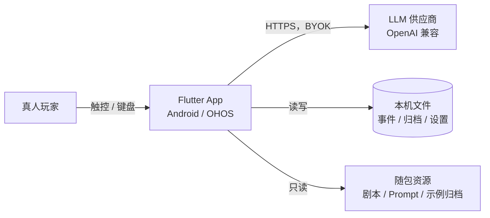

外部依赖只有两个：LLM 供应商、本机文件系统。没有数据库服务、没有账号体系、**不与任何外部仓库或云端交换存档**。

---

## 2. 整体架构

### 2.1 形态：单机客户端

手机即全部运行环境，App 直连 LLM 的 OpenAI 兼容接口，API key 存在本机安全存储里。

**被排除的形态与原因**（记录一次，避免反复纠结）：

| 形态 | 本可带来 | 为什么不做 |
|---|---|---|
| Flutter + 自建后端 | 服务端骰子权威、跨设备同步 | 每次玩要开电脑；违背 clone 即跑 |
| 云托管 / BaaS | 公开页、key 不落手机 | 引入账号、费用、合规；PRD 不做账号 |
| 端侧小模型 | 零成本离线 | 手机端中文跑团质量不足；包体与发热不可接受 |

**这个形态的代价**：

1. 没有服务端随机权威 → 骰子改为「本地随机 + 先落库 + LLM 无权改」（§3.4）；
2. key 在手机上 → 靠系统安全存储，能挡普通读取，挡不住 root（§4.8）；
3. 不能分享 → 归档只在本机，**不导出**（V-13）；
4. 模型行为会漂移 → 靠 prompt 版本号 + 20 局评估兜住（§9.6）。

### 2.2 分层与依赖规则

```
┌──────────────────────────────────────────────────────┐
│ presentation   四屏 + 组件（Flutter Widget）           │
├──────────────────────────────────────────────────────┤
│ application    用例编排：开局 / 一 beat / 插话 / 审核 / 归档 │
├──────────────────────────────────────────────────────┤
│ domain         状态机 · 规则 · 骰子 · 知识 · 场景 · 审核规则 │  ← 纯 Dart
├──────────────────────────────────────────────────────┤
│ infrastructure  LLM · 存储 · 随机源 · 时钟 · 平台能力      │
└──────────────────────────────────────────────────────┘
```

**四条硬性依赖规则**（可写进 lint）：

1. `domain` 不 import `flutter/*`、`dart:io`、`http`；
2. `domain` 只依赖抽象：随机源、时钟、LLM、存储都以接口注入；
3. `application` 可以调 `domain` 与 `infrastructure` 的接口，但不拼 prompt（拼 prompt 属于 `infrastructure/llm`）；
4. UI 只读 `application` 暴露的不可变视图状态，不直读文件。

### 2.3 异步与并发模型

| 主题 | 设计 |
|---|---|
| 并发粒度 | **同一时刻只允许一个 beat 在飞**（single-flight）；AI 之间不并发发言。 |
| 请求方式 | D-15 选 `dio`：整段 JSON 返回，不做 token 流式（配合 D-12 按段显示）。 |
| 取消 | 每次调用持 `CancelToken`；插话触发取消，取消要传到 HTTP 层。 |
| 重试 | 只对网络错误 / 429 / 5xx 重试，指数退避最多 2 次；**不重试骰子**。 |
| 落盘 | 每个 beat 结束批量写文件；写入是 `await` 的，失败即报错。 |
| 重计算 | 归档生成、评估脚本可放 `Isolate`。 |
| 前后台 | 进后台暂停 beat，回前台继续；不做崩溃恢复（V-14）。 |

### 2.4 组件图

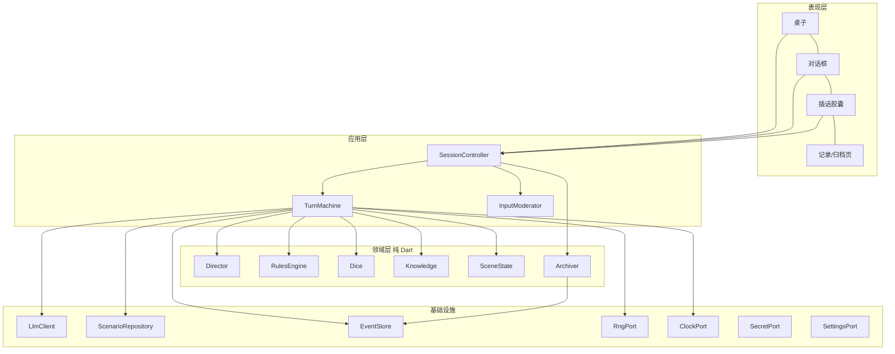

一次 beat 的固定顺序（这就是 PRD「先声明、后掷、再叙述」的工程化）：

```
Director.pickActor
  → Knowledge.buildBundle(actor)      // 只含该行动者可见事件
  → LlmClient.chat(jsonMode)          // 行动者输出结构化 JSON
  → 校验 + 修复（失败则降级）
  → [若声明检定] RulesEngine.declare → Dice.roll → 落库
  → 行动者第二轮：KP 按骰值叙述（不得改骰值）
  → SceneState.apply(deltas)
  → EventStore.append(...)
  → Director.evaluateScene            // 继续 / 转场 / 结算
```

### 2.5 会话生命周期

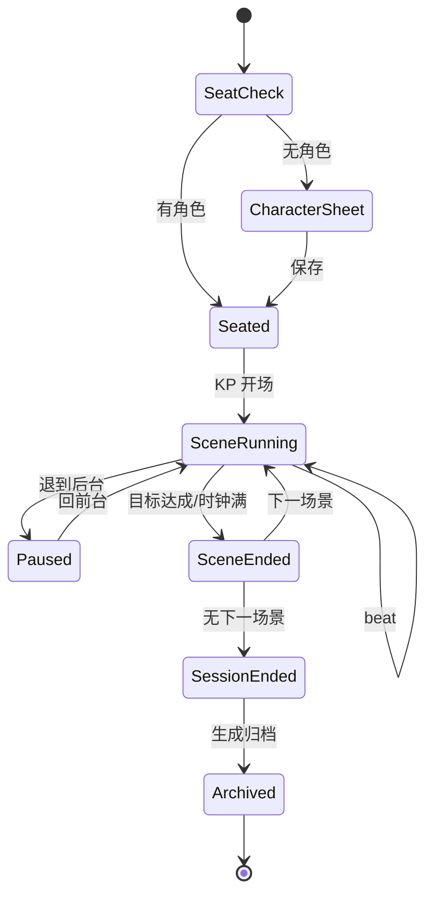

**不变量**：`SceneRunning` 之外不发起 LLM 调用；`Archived` 之后不再写事件。

### 2.6 平台适配层（Android + OHOS）

> **插件预算 ≤ 3 个。每个插件都包在 port 后面，并且必须有第二个实现（纯 Dart 或自写通道）。**

| 能力 | Port | Android | OHOS | 兜底 |
|---|---|---|---|---|
| 应用私有目录 | `FileDirsPort` | `path_provider` | OHOS 版 `path_provider` 或自写 MethodChannel（`context.filesDir`，约 30 行） | 自写通道 |
| 键值设置 | `SettingsPort` | `shared_preferences` | 同上（社区有适配） | 自写 JSON 文件 |
| 密钥 | `SecretPort` | `flutter_secure_storage`（Keystore） | 优先系统安全存储；插件不通则**纯 Dart AES-GCM**（设备指纹派生） | AES-GCM 文件 |

**明确不做**：选图/拍照（V-8）、分享（V-13）、音效（V-15）、导出/导入（V-13）。

**验证顺序**：先用 200 行「探针 App」在两个平台真机各跑一遍这 3 个能力，跑不通的能力当场定兜底，别等做到跑团页才发现存不了 key。

### 2.7 目录结构（D-01 = B；实际落点见 V-18）

实际实现（2026-10-21 起）全部在 Flutter 工程的 `lib/` 下，`engine` 目录仍然保持「不 import flutter」：

```
D:\aiWorkspace\flutter\
├─ PRD/
├─ SE/
├─ ai_paotuan_aroundmeeting/
│  ├─ lib/
│  │  ├─ main.dart               # ProviderScope + MaterialApp.router
│  │  ├─ app/                    # di.dart（Provider）、router.dart、theme.dart
│  │  ├─ engine/                 # 纯 Dart 内核（不 import flutter）
│  │  │  ├─ rules/               # character_rules / attributes / skills / character_sheet / check
│  │  │  ├─ dice/                # RngPort、SecureRng、rollDie
│  │  │  ├─ director/            # 选人、轮次、硬规则
│  │  │  ├─ knowledge/           # audience / game_event / knowledge_filter
│  │  │  ├─ moderation/          # ContentScope、LocalModerator
│  │  │  ├─ scenario/            # 模型、YAML 解析、lint
│  │  │  └─ turn/                # 状态机、事件、效果
│  │  ├─ features/               # home / scenario_select / character_sheet / table / journal / settings / how_to_play
│  │  ├─ ui/                     # wood_button / parchment_panel / stat_bar / seat_avatar / dice_card
│  │  └─ platform/               # ports.dart + platform_impl.dart（3 个插件）
│  ├─ assets/scenarios/dinner_hale/scenario.yaml
│  ├─ test/                      # engine/* 单测 + app_smoke_test
│  └─ android/  ohos/  web/ …
└─ README.md
```

**为什么仍然值得守住 `lib/engine` 不 import flutter**：它现在用 `flutter test` 跑（因为宿主是 Flutter 包），但文件本身零 Flutter 依赖，将来提取成 `packages/engine` 只需要搬目录 + 加一个 pubspec，约 1 小时。

> `ohos/` 已由脚手架生成，说明 Flutter 是 OHOS 分支。**先确认能出 HAP**，再写业务代码。

---

## 3. 领域内核设计

内核决定这是「一群聊天机器人」还是「一个跑团」。这一章只讲规则与状态，不讲像素。

### 3.0 为什么需要「编排」

**一句话：LLM 只会「演一句」，不会「管一局」。** 它没有记忆、没有手、没有钟，也不会停。

| LLM 天生做不到 | 没人管会怎样 | 谁来管 |
|---|---|---|
| 记住上一拍谁说的、说到哪 | 抢话、重复、自问自答 | 编排 + `EventStore` |
| 决定下一个谁开口 | 冷场或一人独白 | 编排调 `Director` |
| 决定成败、掷骰 | 讨好玩家、事后改数 | 编排调 `RulesEngine` + `Dice` |
| 被打断就停 | 两条输出同时写屏 | 编排的取消 |
| 控制成本与节奏 | 无限循环、烧钱 | 编排的预算与熔断 |
| 只知道自己该知道的 | 说出别人的秘密 | 编排调 `Knowledge` |

**编排负责的 10 件事**：① 一次只推进一拍 ② 选人 ③ 组可见上下文 ④ 调模型并校验输出 ⑤ 串行化「声明→掷→叙述」 ⑥ 应用时钟/线索/态度 ⑦ 判转场与结局 ⑧ 处理打断与取消 ⑨ 预算熔断与失败降级 ⑩ 事件落盘。

**它不是 prompt，不等于 Director，也不是工作流引擎**：Director 只是它内部的一个「选谁」策略；它本体是一条 `reduce(状态, 事件) → (新状态, 效果)` 的纯函数（D-03 = A）。

### 3.1 回合状态机（D-03 = A）

> 分层注意：会话级状态（§2.5）管「这一局在不在进行」，beat 级状态（下表）管「这一拍走到哪」。两层不共享枚举。

| 状态 | 含义 | 出边 |
|---|---|---|
| `Idle` | 无进行中 beat | `Picking` |
| `Picking` | Director 算下一个行动者 | `BuildingContext` |
| `BuildingContext` | 组上下文包（只含可见事件） | `Generating` |
| `Generating` | 等行动者输出（整段 JSON） | `DeclaringCheck` / `ApplyingState` / `Interrupted` / `Failed` |
| `DeclaringCheck` | 等 KP 声明技能/难度/代价 | `Rolling` |
| `Rolling` | 骰值已定、落库中 | `Narrating` |
| `Narrating` | KP 按骰值叙述 | `ApplyingState` |
| `ApplyingState` | 应用时钟/线索/态度 | `Evaluating` |
| `Evaluating` | 判继续 / 转场 / 结算 | `Picking` / `Transitioning` / `Ending` |
| `Transitioning` | 写场末文本、换布景 | `Picking` |
| `Ending` | 判结局、封归档 | `Idle` |
| `Interrupted` | 被插话打断，等玩家输入 | `Picking` |
| `Failed` | 本 beat 失败（网络/schema/预算） | `Picking` |

**不变量**：

1. `Rolling` 只能从 `DeclaringCheck` 进入，骰值落库后不可变；
2. `Narrating` 阶段只能拿到骰值的只读副本，没有任何接口能改骰；
3. 每次 `Interrupted` 必须写 `interjection` 事件，否则记录里会出现「无源之语」。

```dart
// domain/turn/turn_event.dart
sealed class TurnEvent { const TurnEvent(); }
final class ActorPicked       extends TurnEvent { final ActorId who; final PickReason why; }
final class ActorProduced     extends TurnEvent { final ActorTurn turn; }
final class CheckDeclared     extends TurnEvent { final CheckDecl check; }
final class DieRolled         extends TurnEvent { final Roll roll; }
final class NarrationProduced extends TurnEvent { final Narration n; }
final class InterjectRequested extends TurnEvent { final String text; }
final class BeatFailed        extends TurnEvent { final BeatError error; }

// domain/turn/effect.dart —— 副作用只能通过效果表达
sealed class Effect { const Effect(); }
final class CallActor      extends Effect { final ContextBundle bundle; }
final class CallKpNarration extends Effect { final CheckResult? result; }
final class PersistEvents  extends Effect { final List<GameEvent> events; }
final class ShowSegment     extends Effect { final ActorId from; final String text; }
final class ShowDice       extends Effect { final Roll roll; }
final class CancelInFlight extends Effect { const CancelInFlight(); }

// domain/turn/turn_machine.dart —— 纯函数，无 await、无 I/O
(TurnState, List<Effect>) reduce(TurnState state, TurnEvent event);
```

**为什么必须纯函数**：一局 27 个 beat、每 beat 2–3 次 LLM 调用，出问题时要能「把事件流喂回去看第 14 拍为什么变了」。命令式写法做不到，纯函数可以，且不需要真调 LLM。

#### beat 预算（Q-06：条数为主、时间为辅）

| 计数器 | 上限 | 性质 | 触发后 |
|---|---|---|---|
| 本 scene beat 数 | 15 | **硬** | 强制转场或结算 |
| 本局 beat 数 | 45 | **硬** | 收束：推进时钟、进结局 |
| 本 beat LLM 调用 | 3 | **硬** | 进 `Failed`（防死循环烧钱） |
| 玩家沉默 beat | 3 | 软 | 提示 |
| 本 scene 已耗时 | 25 min | 软 | 给 KP 一条「可收束」提示，不强制 |

> 时间只作为 `soft_hint` 进 bundle，**不进状态机判定**；代码里用 `Budget.isHard` 区分，否则又会变成「按时间杀局」。

### 3.2 Director：谁来说话（D-04 = A）

#### 硬规则（优先于打分）

| 条件 | 动作 | 理由码 |
|---|---|---|
| 玩家点了「该我了」 | 立刻给玩家 | `player_requested` |
| **本轮所有非玩家行动者都已各行动一次，玩家本轮尚未发言** | **强制给玩家** | `round_complete` |
| 玩家已 3 beat 未发言 | 给玩家 | `human_silent_3` |
| 上一 beat 是玩家且失败 | 给一个 BP 补位 | `backup_after_fail` |
| scene 已结算 | 不进 beat，直接转场 | `scene_closed` |
| 已到 beat 上限 | 收束 | `budget_exhausted` |

> **修正说明（你的第 1 条）**：旧写法「连续两个 AI→AI beat 就给玩家」是错的——它会让玩家在被连续跳过两次后才被想起，却不管全场是否轮完。现改为**按轮（round）计算**：一轮 = 每个非玩家行动者各行动一次；一轮走完且玩家本轮没说话，就**一定**轮到玩家。这才是「轮转完全场后必给玩家」。
>
> 相应地，0 个 BP 的两局（你 + NPC）里，NPC 行动一次即视为一轮结束，下一步直接给玩家。

#### 软规则（打分，选最高）

```
score(actor) =
    40 * clamp(3 - beatsSince(actor), 0, 3)      // 冷落补偿
  + 30 * relevance(actor, lastBeat)              // 话题/线索/技能相关性
  + 25 * goalUrgency(actor)                      // 本场目标是否被逼到墙角
  + 15 * (actor.isHuman ? 1 : 0)                 // 轻微偏向真人
  - 20 * (actor == lastSpeaker)                  // 别连着说
  + rng.nextInt(10)                              // 抖动
```

`relevance` / `goalUrgency` 从剧本标签算（角色标签 ∩ 当前线索 ∩ 当前话题），**不让 LLM 判**：可复现、零成本、零延迟。

**人数边界（Q-01）**：桌上 2–6 人，BP 可为 0。

- 2 人局（你 + 1 NPC）：`backup_after_fail` 退化为「让 NPC 反应或 KP 推进」；
- 只有一个可选对象时直接返回，不做无意义比较；
- 0 BP 时不存在「AI→AI」，轮次由 NPC 与玩家交替构成。

### 3.3 检定（D-05：目标 = 角色技能值）

**规则**：d100 roll-under；技能 1–99；困难 = 技能减半；极难 = 1/5。大成功/大失败**分两档**，档位由**基础技能值**决定：

| 基础技能 | 大成功 | 大失败 | 普通成功 | 普通失败 |
|---|---|---|---|---|
| **≥ 50**（宽档） | 1–5 | 100 | 6 – 目标值 | 目标值+1 – 99 |
| **< 50**（窄档） | 仅 1 | 96–100 | 2 – 目标值 | 目标值+1 – 95 |

对照你的例子：妙手 40 → 1 才大成功、41 以上失败、96–100 大失败；侦查 80 → 1–5 大成功、6–80 成功、81–99 失败、100 大失败。

```dart
enum Difficulty { regular, hard, extreme }
enum Outcome { critical, success, fail, fumble }

bool isWideTier(int baseSkill) => baseSkill >= 50;

int targetFor(int baseSkill, Difficulty d) => switch (d) {
  Difficulty.regular => baseSkill,
  Difficulty.hard    => (baseSkill / 2).floor(),
  Difficulty.extreme => (baseSkill / 5).floor(),
};

Outcome judge({required int die, required int baseSkill, required Difficulty difficulty}) {
  final target = targetFor(baseSkill, difficulty);
  if (target <= 0) return Outcome.fail;          // 未受训 / 神话 0
  final wide     = isWideTier(baseSkill);
  final critHigh = wide ? 5 : 1;
  final fumbleAt = wide ? 100 : 96;
  if (die >= fumbleAt) return Outcome.fumble;
  if (die <= critHigh) return Outcome.critical;
  return die <= target ? Outcome.success : Outcome.fail;
}
```

**档位看基础技能、不看打折后目标值**：难度只说明「这次更难」，不该顺带削掉大成功能力。

**三个边角**：

1. 窄档技能 40 做极难（目标 8），掷出 1 仍是大成功；
2. 宽档不存在「大成功但超过目标」：宽档最低目标 50÷5 = 10 > 5；
3. `target ≤ 0` 直接判失败，避免「神话 0 骰出 1 = 大成功」。

**谁决定什么**：

| 环节 | 谁 | 产出 |
|---|---|---|
| 选技能 + 难度 + 代价 | KP（LLM） | `<check>` 声明（不含目标值） |
| 算目标值 | RulesEngine（Dart） | `target = targetFor(baseSkill, difficulty)` |
| 掷骰 | Dice | `die` |
| 评级 | RulesEngine | `critical / success / fail / fumble` |

**边界**：KP 声明了卡上没有的技能 → 按该技能基础值处理并记 `warn`；声明「神话」→ 基础值 0。

### 3.4 骰子（D-06）

**底线**：骰值不能由 LLM 产生，也不能被 LLM 修改。三条工程约束：

1. 骰值只由 `Dice` 生成（别处没有任何入口能造出 `Roll`）；
2. 骰值**先写 `rolls` 与 `events`，再让 KP 叙述**——顺序反了就等于允许事后编数字；
3. KP 的 prompt 里只有骰值的只读副本，输出协议里没有「改骰值」的字段。

```dart
// packages/engine/lib/src/dice/dice.dart
int rollDie(RngPort rng) => rng.nextInt(100) + 1;   // 1–100

// 生产实现用 Random.secure()：不是为了防作弊，而是避免同一秒
// 多次开局落到同一条伪随机序列上（真的会遇到表现怪的局）。
```

**不做**：种子承诺、HMAC、commit-reveal、外部熵、归档复算。单机单人，能作弊的只有你自己；算法越复杂越容易引入 bug（取模偏差、序号错位），反而伤掉「骰子是真的」这一观感。

**日志字段**：`roll_seq` / `actor` / `skill` / `base_skill` / `difficulty` / `target` / `die` / `outcome` / `stakes` / 时间。不用于密码学校验，只用于记录页展示与归档留档。

### 3.5 知识边界（D-07 = A）

崩法很具体：Stella 的 bundle 里混进了别人的秘密，于是她开始说「老陈你那本账本」——剧情当场穿帮。

#### 事件可见性模型

| audience | 含义 | 谁看得到 |
|---|---|---|
| `public` | 桌面公开对话/旁白 | 所有人 |
| `kp` | 只有 KP 知道的剧本事实 | KP |
| `private:[actor_id]` | 某角色的秘密、内心 | 该角色 + KP |
| `party` | 玩家阵营共享的已知信息 | 玩家 + BP |

```dart
List<GameEvent> visibleTo(ActorId a, Iterable<GameEvent> all) => all.where((e) =>
    e.audience.any((t) =>
        t == Audience.public ||
        (t == Audience.kp && a.isKp) ||
        (t is PrivateTo && t.actor == a) ||
        (t == Audience.party && !a.isNpc))).toList();
```

**关键点**：过滤发生在 `BuildingContext`，**不是**发生在 prompt 措辞里。秘密在物理上没进入字符串，LLM 想泄露也无从泄露。这条直接支撑「信息泄露 = 0」。

#### 备选机制（按你的要求保留，本期不实现）

| 选项 | 特点 | 优点 | 缺点 | 何时考虑 |
|---|---|---|---|---|
| **A（已选）事件可见性过滤** | 拼 prompt 前按 audience 裁事件 | 确定性、可单测、零成本、泄漏面在拼接前被切断 | 需要剧本正确标注 audience | 现在 |
| **B 每角色私有摘要记忆** | 每 5–8 beat 让 LLM 为每个角色更新「我记得什么」 | 长局不爆上下文，记忆更像人 | 摘要由 LLM 写，可能记错；每 5–8 beat 多 3–5 次调用；不可复现 | 单局超过 20 beat 后 |
| **C 双轨（A 硬边界 + B 软记忆）** | 先过滤再摘要 | 长局与安全兼得 | 实现量最大，两条链路都要测 | 做完整三幕时 |
| **D 全公开** | 所有事件进所有 prompt | 省事、有时很欢乐 | 秘密机制失效，「她为什么知道」成为常态 | 只适合纯搞笑模式 |

> 本期只做 A。B/C 是升级路径，不是未决策项；等单局 beat 数稳定超过 20 再评估。

### 3.6 场景 / 时钟 / 线索 / 结局

```yaml
scene: porch
goal: 让顾先生接受晚宴邀请
clocks:
  - { id: gu_patience, label: 顾先生的耐心, max: 3, on_zero: refuse_and_close_door }
clues:
  - id: clue_recent_meeting
    text: 他刚结束一场会面
    reveal_when: { any: [check.success:话术, check.success:侦查] }
  - id: clue_cuff_mud
    text: 他袖口有泥
    reveal_when: { check: { skill: 侦查, outcome: [success, critical] } }
exits:
  - { id: invited, when: { flag: gu_accepted_invite }, to: dining_room }
  - { id: refused_but_watched, when: { clock_at_zero: gu_patience }, to: street_watch }
checks:
  # 不写目标值：目标来自角色技能（D-05）
  - { skill: 话术, difficulty: regular, stakes: 失败则他礼貌拒绝 }
  - { skill: 心理学, difficulty: regular }
  - { skill: 侦查, difficulty: hard }
```

**结算规则（确定性，不交给 LLM）**：

| 事件 | 状态变化 |
|---|---|
| 社交检定失败 | `gu_patience -1` |
| 检定大失败 | `gu_patience -1`，且暴露意图 flag |
| 时钟到 0 | 触发 `on_zero` 出口 |
| 线索条件命中 | 写 `clue_revealed`（audience: party） |
| 目标 flag 成立 | 进 `Evaluating` → 出口 |

**为什么必须确定性**：LLM 负责「演」，规则负责「判」。结算在 Dart 里，评估时才能准确说出「这局为什么进了结局 C」。

### 3.7 角色卡与派生属性

数值全在 `packages/engine/lib/src/rules/character_rules.dart` 的常量表里；改数值不改逻辑。

| 项 | 规则 |
|---|---|
| 基础属性 | 8 项：力量/敏捷/意志/体质/智力/魔法/幸运/外貌。初始各 50（合计 400），**可分配 60，总和固定 460**；单项 **15–90** |
| 技能 | 见下表；**技能点 = 智力 × 2**；可分配项单项 ≤ 70 |
| HP | `体质 / 5 + 5`（向下取整）：体质 50 → 15 |
| MP | `意志 / 5`（向下取整） |
| SAN | **可损**，初始 = 意志，之后独立下降；归零 = 崩溃（结局判定用） |
| 幸运 | 参与 8 项分配（15–90）；本期只显示，不参与检定 |
| 物品 | ≤ 5 格，名称 + 一句话；可带标签（线索/武器/信物） |
| 外观 | **通用头像**：姓名首字母 + 由名字 hash 决定的角色色；无上传、无裁剪 |

#### 技能表（9 项）

| 技能 | 基础值 | 可分配 | 用途 |
|---|---|---|---|
| 神话 | 0 | ❌ | 只能通过接触神话获得 |
| 侦查 | 25 | ✅ | 找线索、看细节 |
| 聆听 | 20 | ✅ | 隔门偷听、听脚步 |
| 图书馆 | 20 | ✅ | 查资料（后续场景） |
| 潜行 | 20 | ✅ | 跟梢、溜进院子 |
| 心理学 | 10 | ✅ | 读人、判断谎话 |
| 妙手 | 10 | ✅ | 掏口袋、换东西、开锁 |
| 话术 | 5 | ✅ | 说服、套话 |
| 闪避 | 敏捷 ÷ 2 | ❌ | 派生，随敏捷自动变化 |

**校验（保存时硬拦）**：姓名非空 ≤ 12 字；8 项和 = 460 且每项 15–90；已分配技能点 ≤ 智力×2，每项 ≤ 70；物品 ≤ 5；允许留余点（提示），不允许超支。

### 3.8 插话（D-08 = C′）

| 当前谁在说话 | 插话按钮 | 行为 |
|---|---|---|
| **BP / NPC** | 可用 | 立即取消其生成，话筒交给玩家 |
| **KP** | **不可用（置灰）** | 等 KP 叙述结束；不给排队，避免玩家误以为能插 |
| **骰子结算 / 掷骰动画** | **不可用（置灰）** | 结算完自动恢复 |
| 玩家自己发言 / 空闲 | 可用 | 直接进入输入 |

```
玩家点「插话」
  ├─ 当前是 BP / NPC 在说 → CancelInFlight → 丢弃未上屏内容 → Interrupted → 输入
  ├─ 当前是 KP 在说       → 按钮置灰（无动作）
  ├─ 当前在 Rolling/Narrating → 按钮置灰（无动作）
  └─ 当前是玩家发言或空闲 → 直接输入
```

**为什么 KP 与骰子不可打断**：KP 的叙述承载判定结果与世界观信息，打断会留下「没有结果的判定」；骰子结算中打断会让「声明→掷→叙述」断链。BP/NPC 是同级玩家，抢他们的话最自然，也最安全。

**残句处理（Q-05）**：输出是整段 JSON（D-17），所以取消通常发生在**上屏之前**，此时整段丢弃、不留残句；若确已上屏一部分，末尾补 `……`，表示「前一个人没说完」。记录里不写「你打断了 X」这种旁白。

**打断必须留痕**：`interjection` 事件（`actor: human`，payload `{target_actor, phase, cut_at_char}`），供记录页与高光识别使用。

### 3.9 玩家输入审核（D-28 = B）

这是本版新增、且被标为最关键的机制：**每条玩家话语在进入 beat 之前必须过审**。

#### 两级管线

```
玩家点发送
  → ① 形式校验（0 成本）：空 / 超长(>200 字) / 重复刷屏 / 纯表情
  → ② 本地规则（0 成本）：违法、未成年、露骨、极端暴力、真实人物、现代梗
  → ③ 判定
       ├─ 命中硬规则 → reject（stage = local）
       ├─ 明确安全   → allow（stage = local）
       └─ 不确定     → 交 ④
  → ④ LLM 审核（1 次小模型调用）：输入 = 玩家原话 + 剧本边界摘要 + 最近 3 条公开对话
       输出 JSON：{ verdict: allow|reject, category, reason_in_world }
  → ⑤ 结果：allow → 正常进 beat；reject → KP 口吻驳回，输入框内容保留
```

**为什么两段**：纯 LLM 每条都调用，成本与延迟直线上升；纯本地规则拦不住语义级、剧本外的东西。两段把 90% 的输入在本地判掉，只有模糊的才付费。

#### 剧本边界（审核的判据来源）

剧本 YAML 必须声明 `content_scope`，审核 prompt 直接引用它：

```yaml
content_scope:
  era: 1935 · 上海法租界
  genre: 悬疑 / 社交 / 心理恐怖
  rating: 16+
  allowed: [谈判, 试探, 欺骗, 潜入, 威胁, 有限的暴力]
  forbidden: [性内容, 未成年人伤害, 虐待细节, 真实人物影射, 现代科技, 出戏元话语]
  intent: 玩家应在剧本的时空与题材内行事
```

#### 判定与驳回

| 情况 | 处理 |
|---|---|
| 通过 | 正常进 beat，记录一条 `input_allowed`（仅 metadata） |
| 驳回（本地） | 不进入 transcript；KP 用戏内口吻驳回；记 `input_rejected`（category、长度，**不存原文**） |
| 驳回（LLM） | 同上，另外保留 `reason_in_world` 供 KP 生成台词 |
| 连续 3 次驳回 | 输入框上方一行提示「要不换个说法？」（不弹窗） |
| 审核服务不可用 | **fail-closed**：提示「现在没法判断这句话，稍后再试」，给重试按钮；记 `warn` |

**驳回的措辞**：不说「系统禁止」，而是戏内拒绝。例：

- 违规：「顾先生的笑容淡了一点。『这话……不像今晚该说的。』」
- 出戏（现代梗）：「Stella 看了你一眼，低声说：『你刚才那是什么词？』」

**审核的边界**：

- 只审玩家输入（NPC/BP 的输出走另一套禁语检查，见 §4.10）；
- 审核**不改写**玩家的话，只放行或驳回；
- 审核结果不影响骰子、不影响时钟——它不是游戏机制，是安全阀；
- 审核调用会把玩家原话发给供应商，这一点要在设置页的隐私说明里写明。

#### 成本与延迟

| 项 | 目标 |
|---|---|
| 本地规则 | ≤ 5 ms |
| LLM 审核 | ≤ 1.5 s（小模型，`max_tokens` 120） |
| 命中率预期 | 约 10–20% 输入需要走 LLM（其余本地判定） |

---

## 4. 模块设计

### 4.0 模块总览

| 模块 | 职责 | 依赖 | 主要失败模式 |
|---|---|---|---|
| `app/shell` | 启动、依赖装配、主题、竖屏、路由 | 全部 | 平台端口不可用（OHOS） |
| `features/home` | 五个木牌按钮 | 无 | 无 |
| `features/scenario_select` | 两个剧本入口、前置校验 | settings、character | key 缺失 |
| `features/character_sheet` | 8 属性 + 9 技能 + 物品；通用头像 | storage | 点数校验 |
| `features/table` | 桌子、对话框、插话、骰子卡、记录入口 | engine、llm | 延迟、流中断、状态竞争 |
| `features/journal` | 归档列表与详情（只读、不导出） | archive store | 大文件读取慢 |
| `features/settings` | key、模型、呈现、关于 | secret、settings | key 校验失败 |
| `engine/turn` | 状态机、Director、预算 | 无（纯） | 状态泄漏、死循环 |
| `engine/rules` | 检定、派生、结算 | 无（纯） | 档位边界（技能 50 两侧） |
| `engine/dice` | 随机数 | RngPort | 调用方绕过 Dice 造骰值 |
| `engine/knowledge` | 可见性过滤、bundle | 无（纯） | 标注错误导致泄漏 |
| `engine/moderation` | 本地规则审核 | 无（纯） | 词表误杀 |
| `engine/archive` | 归档生成 | storage | 写到一半 |
| `llm/client` | dio、超时、重试、取消、用量 | dio | 429/超时/证书 |
| `llm/prompt` | 模板、组装、JSON 校验、修复 | 无（纯） | 模板漂移 |
| `scenario` | YAML schema、校验、加载 | yaml | 剧本写错 |

**装配原则**：所有 Port 只在 `app/shell` 里 new 一次并注入；**不允许 UI `new` 基础设施**，否则「假 LLM 测试」就做不成。

### 4.1 外壳、导航与四屏（D-09 = A，D-10 = A）

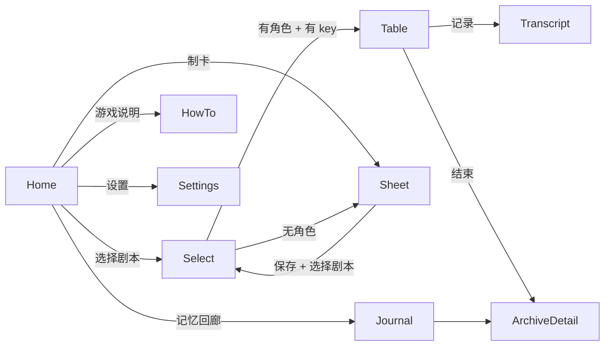

**D-10 已定**：`go_router`，纯 Dart、无平台插件，路由表集中在 `app/app/router.dart`。

**不做崩溃恢复（V-14）**：不写「杀进程后回到原处」的策略，不打恢复快照，不存 `lastSessionId` 续局入口。玩家退出即本局结束（未结束的局不生成归档，只留在本地工作文件里，不提供入口）。这条是为了先跑通，不是遗漏。

#### D-09 状态管理（已定：Riverpod）

**结论**：`flutter_riverpod`。唯一理由：**一行 `overrideWithValue` 就能把真 LLM / 真存储换掉**——直接支撑「假 LLM 测试」与「20 局评估」。其余优点（细粒度重建、`AsyncValue`）都算附赠。

**装配方式**：

- `main.dart` 外面包一层 `ProviderScope`；
- 所有基础设施 Port 在 `app/app/di.dart` 里声明为 `Provider`，**默认实现是 `throw UnimplementedError()`**——忘记注入会立刻炸，而不是静默跑假数据；
- 业务状态一律不可变（`copyWith`），用 `Notifier` / `AsyncNotifier` 持有。

**首批 Provider 清单**：

| Provider | 类型 | 持有 |
|---|---|---|
| `fileDirsProvider` | `Provider` | `FileDirsPort` |
| `settingsProvider` | `Notifier` | 设置（模型、呈现方式、动效） |
| `secretProvider` | `Provider` | `SecretPort` |
| `llmProvider` | `Provider` | `LlmPort` |
| `scenarioProvider` | `Provider` | `ScenarioRepository` |
| `eventStoreProvider` | `Provider` | `EventStore` |
| `rngProvider` | `Provider` | `RngPort` |
| `sessionProvider` | `AsyncNotifier` | 当前局的 `SessionView`（不可变快照） |
| `tableInputProvider` | `Notifier` | 输入态：`idle / editing / moderating / rejected` |
| `archiveListProvider` | `AsyncNotifier` | 归档列表 |

**状态形状**：

```dart
@immutable
class SessionView {
  final String sessionId;
  final String sceneName;
  final int partySize;              // 2–6，不含 KP
  final Segment? current;           // 当前显示的段
  final bool busy;                  // 等待 LLM（显示"正在斟酌…"）
  final DiceCard? dice;
  final InterjectState interject;   // enabled / disabled(reason: kp|dice)
}
```

**不变量**：

1. UI 只 `ref.watch(sessionProvider)` 拿只读视图，**拿不到** `TurnMachine` / `EventStore`；
2. 只有 `SessionNotifier` 允许调 `TurnMachine`；
3. 所有 LLM / 存储访问经 Provider 注入，测试里用 `ProviderScope(overrides: [...])`；
4. 不在 `build()` 里做异步副作用（会重复触发）；异步一律 `AsyncNotifier`。

**已否决**：Bloc（会与 §3.1 的 `TurnMachine` 形成两套事件系统，等于把状态机写两遍）、Provider + ChangeNotifier（异步三态手写、注入弱）、手写 `ValueNotifier`（跨页共享与测试注入要自建）。

> **迁移提示**：UI 只依赖 `SessionView`，将来真要换方案，改动面只有 `di.dart` 与 `*_notifier.dart`。

### 4.2 首页 / 选择剧本 / 制卡

**首页**：五个固定顺序木牌 + 版本号，不做动态排序。

**选择剧本**：

```
点「顾先生的晚宴」
  ├─ 无 key  → 提示条：去设置 / 看示例归档（不弹 modal）
  ├─ 无角色 → 跳制卡（带「完成后自动上桌」标记）
  └─ 就绪   → 建 session → 上桌
点「自定义剧本」→ 一句话弹窗「开发中」+ 关闭
```

**制卡**：属性条（拖动/点按增减，长按加速，8 项和 460 实时校验）、技能 9 项（基础值固定，可分配点 = 智力 × 2，闪避 = 敏捷 ÷ 2 自动算）、派生值实时计算、通用头像、物品 5 格。草稿每 2 s 自动写一次；正式保存时全量校验。

### 4.3 跑团页布局（D-11 = B + A）

| 区域 | 高度占比 | 内容 | 约束 |
|---|---|---|---|
| 顶栏 | 8% | 场景名 / 人数 `4/6` / 记录 | 人数 = 玩家 + BP + NPC，不含 KP |
| 桌子 | 42–47% | 座位、状态、说话高亮 | 2–6 个参与者座位 + 1 个 KP 位 |
| 对话框 | 25–30% | 名牌 + 正文 + 「继续 ▼」 | 只显示当前段 |
| 输入区 | 0 / 18% | 输入框 + 3 建议 + 换一批 | 键盘弹起时桌子压缩 |
| 插话胶囊 | 常驻右侧 | 56×120 dp | 按 §3.8 的状态启用/置灰 |

**渲染方式（D-11）**：桌面用一张位图打底（`BoxFit.cover`，按屏宽解码），座位高亮、指向线、光晕、骰子用 `CustomPainter` 叠在上面。素材只出 1–2 套分辨率，不做多套响应式图。

**座位算法**：椭圆基准；KP 固定 12 点；玩家固定 6 点；BP 均分左右弧；NPC 用「加座」放最外侧。人数变化只重算角度。

**人数口径（Q-01）**：门廊 = 4/6（你 + Stella + 老陈 + 顾先生）。**BP 可为 0**（最少 2 人局），Director 与布局都必须支持。

### 4.4 对话框与文本呈现（D-12 = D）

**结构**：羊皮纸容器 → 名牌（`KP` / `Stella · BP` / `顾先生` / `你`）→ 正文（最多 3 行视高，超出渐隐）→ 右下 `▼`（下一段）。

**呈现方式**：**整段出现 + 80–120 ms 淡入**，不做逐字。理由（你的第 4 条）：

1. 打断时不会留下半句，「下一次 beat 的 prompt 里出现残句」这个隐患从根上消失；
2. JSON 整段返回本来就无法边流边显，逐字反而制造延迟错觉；
3. 实现 20 行，无定时器、无高频重建。

**设置项调整（V-15/V-12）**：PRD 的「文字速度 快/中/慢/瞬间」改为「段落呈现：瞬间 / 淡入（默认）」；不提供逐字速度。

**分段规则**：一次 beat 若含旁白 + NPC 台词，按「旁白 → NPC 台词」分成 2–3 段，各自淡入，`▼` 推进。

### 4.5 骰子卡与动效（D-13 = A）

骰子卡 = 档案卡 + 火漆印：技能 / 目标 / 骰值 / 结果 / 一句后果。大成功金印、大失败裂痕。**必须同时有纯文字版**（无障碍 + golden 稳定）。

**动效范围（极简）**：骰子卡淡入 + 翻面 0.6 s（可跳过）、段落淡入、按钮按下下沉。**不做**：烛光呼吸、粒子、视差、音效。全部用 Flutter 内置动画，零插件。

**动画与网络解耦**：骰值在动画开始前就已落库，动画只是表演。

### 4.6 记录（Transcript）

- 入口：跑团页右上「记录」；归档详情页复用同一渲染器。
- 分组：`scene` → `beat`；每条显示说话人、相对时间、骰子卡（若有）。
- 插话标记：被打断且已上屏的部分以 `……` 收尾，不加旁白行。
- 性能：`ListView.builder` + 分页读取（每次 50 条）。
- **只读**：不允许编辑或删除单条。

### 4.7 记忆回廊（D-24 = D，D-25 = A）

```
列表（按结束时间倒序）
  ├─ 顶部固定一张「示例 · 门廊」卡片（带「示例」角标，只读、不可删）
  ├─ 卡片：日期 · 剧本 · 队伍 · 结局 · 时长
  ├─ 点开 → 详情：结局 / 高光 / transcript / 骰子 / 角色卡
  └─ 删除 → 二次确认 → 整包彻底删除
```

**空状态**：`还没有归档。跑一局，回来看看。`

**不做导出（D-24 = D）**：没有导出按钮、没有分享、没有复制 JSON、没有「发送到文件」。原因（你的第 4 条）：生成内容未必在合规范围内，一旦导出就会脱离本 App 的审核与免责语境。**归档只能在本 App 内看。**

**示例归档（D-25 = A）**：打进 `assets/samples/`，只读展示，不写数据库、不可删除、不依赖网络。

**删除语义（Q-07）**：整包删干净——会话目录、归档记录、索引条目一并删除，不留摘要、不留审计。

### 4.8 设置与密钥（D-14 = A）

| 设置项 | 说明 |
|---|---|
| API key | 存 `SecretPort`，可「测试连接」、可「清除」 |
| 模型 | **KP 模型** + **BP 模型** 两个选择项（不做 GM 配置） |
| 供应商 | 默认 DeepSeek 预设；可选「通用 OpenAI 兼容」（自填 base_url / model） |
| 段落呈现 | 瞬间 / 淡入 |
| 动效 | 开 / 关（跟系统「减少动效」联动） |
| 关于 | 版本、License、致谢、隐私说明 |

**密钥实现（D-14 = A）**：

| 平台 | 实现 | 兜底 |
|---|---|---|
| Android | `flutter_secure_storage`（Android Keystore） | — |
| OHOS | 优先系统安全存储（插件/自写通道） | 纯 Dart AES-GCM，key 由「应用常量 + 设备指纹」派生 |

**设置页必须写的两句话**：

> 「API key 保存在本机安全存储中，不会上传到任何服务器；但已 root 的设备无法保证安全。」
> 「你的对话内容会发送给所选模型服务商（包括用于输入审核的判断请求）。」

**密钥纪律**：key 不进日志、不进归档、不进错误上报、不进 UI 明文显示（只显示后 4 位）。

### 4.9 LLM 接入层（D-15 = B，D-16 = A + C）

**D-15 = B**：用 `dio` 做 HTTP（现成的超时、拦截器、`CancelToken`），SSE 不启用（D-17 用 JSON 整段返回），只需要处理普通 JSON 响应。

**D-16 = A + C**：

| 预设 | 内容 |
|---|---|
| 默认 | DeepSeek（OpenAI 兼容），预置 `base_url` 与模型名，开箱能玩 |
| 通用 | 自填 `base_url` + `model`，适配任何 OpenAI 兼容服务 |

**两个模型档位**：`kp_model`（强一点，负责叙事与判定声明）、`bp_model`（便宜，负责角色台词）。设置页分开选，归档里记录两者名字。

**客户端要吸收的差异**：`response_format` 是否支持（不支持则退化为「只提示 JSON」并在解析层修复）；`max_tokens` 上限；错误体格式；是否支持 `temperature`。

**超时与重试**：连接 10 s、整段 60 s；对网络错误 / 429 / 5xx 退避重试 ≤ 2 次；4xx（除 429）不重试。

### 4.10 Prompt 与 JSON 输出（D-17 = A）

**为什么选 JSON 模式**：配合「按段显示」，整段到齐再解析再上屏，没有半截 JSON 的解析地狱；校验严格、错误可定位；供应商普遍支持。

#### 上下文包（bundle）预算

| 块 | 内容 | token 预算 | 可见性 |
|---|---|---|---|
| `identity` | 身份、脾气、吐槽风格、句长约束 | 150 | 该行动者 |
| `card` | 属性/技能/目标/秘密/关系 | 200 | 该行动者 |
| `scene` | 场景目标、时钟、已揭示线索、在场人 | 200 | 全员（裁剪版） |
| `rules` | d100 摘要 + 「你无权决定成败」 | 120 | 全员 |
| `knowledge` | 可见事件（滑窗，§4.11） | 600–1200 | 按 audience |
| `task` | 本次任务（演一句 / 声明检定 / 按骰值叙述 / 修复） | 120 | 按调用类型 |
| `contract` | 输出 JSON schema + 一个正例 | 200 | 按调用类型 |

单次请求目标：BP ≤ 2.5k prompt token，KP ≤ 4k。

#### 三类输出 schema

**① BP 行动**

```json
{
  "speech": "您好，顾先生，我是 Stella，刚搬到隔壁。",
  "action": "邀请顾先生参加晚宴",
  "intent": "persuade",
  "target": "顾先生",
  "wants_check": { "skill": "话术" },
  "private_note": "不能让他拒绝"
}
```

**② KP 回应（含检定声明）**

```json
{
  "narration": "顾先生扶着门框，目光在你们两人之间来回。",
  "npc_lines": [{ "npc": "顾先生", "line": "按礼节，我不该回绝一位女士。", "attitude_delta": -1 }],
  "check": {
    "actor": "bp_stella",
    "skill": "话术",
    "difficulty": "regular",
    "stakes": "失败他会礼貌拒绝"
  },
  "state": { "clocks": [{ "id": "gu_patience", "delta": -1 }], "clues": ["clue_recent_meeting"] },
  "scene": "continue"
}
```

**③ KP 按骰叙述**（`check` 必须为 `null`，骰值由系统提供）

```json
{
  "narration": "顾先生沉默了三秒，才把门让开一条缝。",
  "npc_lines": [],
  "check": null,
  "state": { "clocks": [], "clues": [] },
  "scene": "continue"
}
```

**字段级约束**：

| 字段 | 约束 | 违约处理 |
|---|---|---|
| `speech` / `narration` | ≤ 400 字 | 截断 + warn |
| `check.skill` | 必须是 9 项技能之一 | 校验失败 → 本拍失败（不重试） |
| `check.difficulty` | `regular/hard/extreme` | 同上 |
| `check.actor` | 必须是本回合行动者（`player/玩家/你` 会被归一） | 认不出则忽略该检定 |
| `npc_lines[].npc` | 必须是剧本已声明的 NPC | 同上 |
| `state.clocks[].id` | 必须是当前场景的时钟 | 忽略并 warn |
| `scene` | `continue/end/transition` | 同上 |
| 全文 | 禁语：`作为AI` / `语言模型` / `我是一个AI` / `系统提示` | 命中即本拍失败 |

**校验与失败**：以 `application` 层的 validator 为准（不依赖供应商 schema）。**不做修复调用、不做重试**（V-24）：一次输出不合法 → 本拍 `Failed`，界面只给「去设置 / 结束本局」，避免重复消耗 token。

**不变量**：schema 里**没有 `target`**，也没有任何能写骰值的字段。目标由角色卡算，骰值由 Dice 给。

### 4.11 上下文策略（D-18 = A）

- 取最近 N 条**可见**事件，按 token 预算截断（约 8–12 beat）；
- 始终保留：场景 brief、角色卡、本场目标、当前时钟与线索摘要；
- 超预算时从最旧的事件开始丢，丢弃时在 bundle 里加一行「（更早的事已被裁掉）」；
- **不做摘要、不做检索**：单场景 15 beat 内，遗忘几乎不会发生。
- 何时升级：单局稳定超过 20 beat 再考虑滚动摘要（§3.5 的 B/C）。

### 4.12 剧本与 Prompt 资源（D-19 = A，D-20 = A）

**YAML 随包**，文件名 `assets/scenarios/dinner_hale/scenario.yaml`。

```yaml
id: dinner_hale
version: 0.4
title: 顾先生的晚宴
content_scope: { era: 1935 上海法租界, genre: 悬疑/社交, rating: 16+, ... }
cast:
  - { id: bp_stella, kind: bp, name: Stella, ... }
  - { id: bp_chen,   kind: bp, name: 老陈,   ... }
npcs:
  - { id: npc_gu, name: 顾先生, audience_default: public }
scenes: [ porch, dining_room, study ]
```

**为什么 YAML**：你最常改的是剧本，YAML 改起来最快、能写注释；`yaml` 包是纯 Dart，OHOS 无风险。

**校验（`tool/scenario_lint.dart`，CI 必跑）**：

1. 所有 id 唯一（scene/clock/clue/exit/check/cast/npc）；
2. `reveal_when` 引用的技能在 9 项技能表内；
3. 每个 scene 至少一个出口，出口可达；
4. `audience` 取值合法；
5. `content_scope` 必填（审核要用）；
6. 每个 BP 至少有 1 个吐槽示例、1 个善变诱因；
7. 文本长度在预算内。

**不做**：热更新、侧载导入、剧本编辑器（V-13 的「不导入」同样适用）。

### 4.13 观测、用量与错误降级

本地观测（D-26：只记元数据）：

| 指标 | 采集点 | 用途 |
|---|---|---|
| 各阶段耗时（审核/生成/校验/掷骰） | engine + llm | 验收延迟 |
| token 与估算成本 | `api_usage` | 单局成本 |
| 修复次数 / 失败次数 | `llm/prompt` | 判断协议是否要调 |
| 审核命中率 / 驳回率 | `engine/moderation` | 调词表 |
| 插话次数 | `engine/turn` | 体验调优 |

**错误降级矩阵**：

| 失败 | 处理 | 用户看到 |
|---|---|---|
| 无 key | 开局前拦截 | 「先在设置里填 API key」+ 两个按钮 |
| 401/403 | 不重试 | 「key 无效或已过期」 |
| 429 | **不重试**（V-24） | 「对方忙，稍后自己再发」 |
| 超时（>60 s） | **不重试** | 「网络慢，本拍已停止」 |
| 网络中断 | **不重试** | 「本拍已停止」 |
| JSON 解析/校验失败 | **不修复、不重试** | 「这一句没能推进剧情」 |
| 审核不可用 | fail-closed | 「现在没法判断这句话」+ 手动重发 |
| 预算超限 | 停 beat，进结算 | 「本场到此为止，去归档看看」 |
| 剧本校验失败 | 拒绝开局 | 「剧本文件有问题」 |

### 4.14 审核模块的接线（D-28）

| 位置 | 做什么 |
|---|---|
| `features/table` 发送回调 | 先调 `InputModerator.check(text)`，`allow` 才进 beat |
| `engine/moderation` | 形式校验 + 本地词表 + 场景边界规则（纯 Dart） |
| `llm/prompt` | 生成审核 prompt（含 `content_scope`） |
| `features/table` 驳回态 | 输入框保留原文 + 顶部一行提示；KP 台词由一次 `reject` 叙述生成 |
| `EventStore` | `input_rejected`（仅 metadata）/ `input_allowed`（仅 metadata） |

> 审核**不阻塞** UI 线程：本地规则同步判（<5 ms），LLM 审核异步等待并显示「KP 正在斟酌……」的等待态（≤1.5 s）。

---

## 5. 数据设计

### 5.1 领域模型

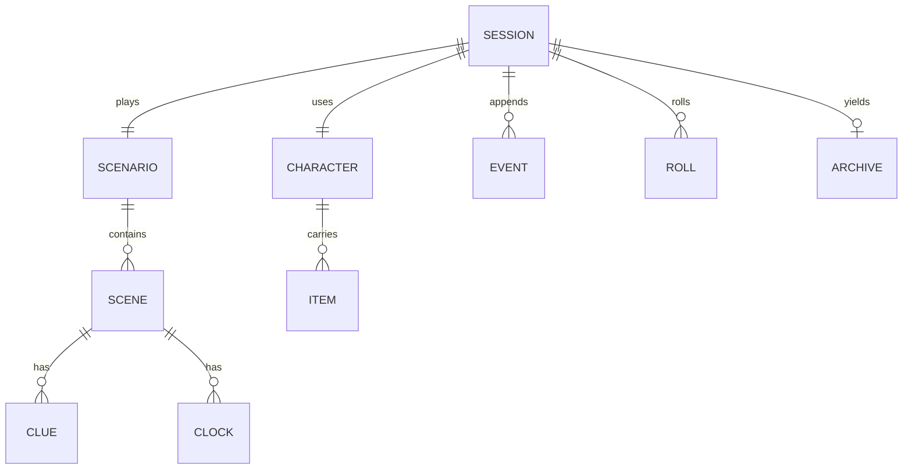

| 实体 | 关键字段 | 说明 |
|---|---|---|
| `Scenario` | id, version, title, content_scope, cast[], npcs[], scenes[] | 只读资源 |
| `Scene` | id, goal, clocks[], clues[], exits[], checks[] | 声明式 |
| `Character` | 8 属性、9 技能、派生、物品、目标、秘密、关系 | `kind` 区分 player/bp/npc |
| `Session` | scenario, character, models, beat_index, status | 一局的根 |
| `Event` | seq, kind, actor, audience, payload | 只追加 |
| `Roll` | roll_seq, skill, base_skill, difficulty, target, die, outcome | 骰值权威 |
| `Archive` | ending, party, party_size, summary | 生成即冻结 |

### 5.2 事件模型

| kind | payload | audience 默认 | 用途 |
|---|---|---|---|
| `session_start` | scenario_id, party[] | public | 开局 |
| `scene_start` | scene_id, goal, clocks | public | 场景开场 |
| `narration` | text | public | KP 旁白 |
| `dialogue` | speaker, text, intent | public | 台词 |
| `action` | actor, text | public | 行动宣告 |
| `check_declared` | actor, skill, base_skill, difficulty, target, stakes | public | 先声明 |
| `roll` | roll_id, die, outcome | public | 骰子落定 |
| `check_result` | outcome, narration | public | 结果叙述 |
| `state_delta` | clock / clue / attitude | public（线索可 party） | 状态更新 |
| `interjection` | target_actor, phase, cut_at_char | public | 插话 |
| `input_allowed` | stage, ms | kp | 审核通过（仅 metadata） |
| `input_rejected` | stage, category, length | kp | 审核驳回（**不存原文**） |
| `scene_end` | exit_id, reason | public | 场景收束 |
| `session_end` | ending_id | public | 结局 |
| `system_error` | code, detail | kp | 调试 |

**事件不可变**：时钟、线索、态度不单独存「当前值」，由事件回放得出。这样回放 = 重放事件，不需要第二套逻辑。

### 5.3 文件布局与字段字典（D-22 = D，纯文件）

```
appData/
├─ sessions/{sessionId}/
│  ├─ session.json          # 一行元数据
│  ├─ events.ndjson         # 追加写，每行一条事件
│  ├─ rolls.ndjson          # 追加写
│  └─ archive.json          # 局末生成，之后只读
├─ characters/{characterId}.json
├─ samples/                 # 随包示例的运行期缓存（只读拷贝，可选）
├─ settings.json
└─ usage.ndjson
```

**字段字典**（NDJSON 每行一个对象）：

| 文件 | 字段 | 类型 | 说明 |
|---|---|---|---|
| `session.json` | `id` | string | `sess_20261021_1930` |
| | `scenario_id` / `scenario_version` | string | 版本不一致不续局 |
| | `character_id` | string | 玩家角色 |
| | `kp_model` / `bp_model` | string | 实际使用的模型 |
| | `status` | enum | `seated/running/paused/ended/archived` |
| | `beat_index` | int | 当前拍 |
| | `started_at` / `ended_at` | int | epoch ms |
| | `party_size` | int | 2–6（不含 KP） |
| `events.ndjson` | `seq` | int | 单调递增，**唯一排序依据** |
| | `kind` | string | §5.2 的取值 |
| | `actor` | string? | 行动者 id |
| | `audience` | string[] | `public` / `kp` / `private:x` / `party` |
| | `payload` | object | 见 §5.2 |
| | `created_at` | int | 展示用，不参与排序 |
| `rolls.ndjson` | `roll_seq` | int | 本局第几次掷骰 |
| | `actor` / `skill` / `base_skill` | string/int | 评级依据 |
| | `difficulty` / `target` | enum/int | — |
| | `die` / `outcome` | int/enum | 1–100 |
| | `stakes` | string | 失败代价 |
| `characters/{id}.json` | `attrs` | object | 8 项，和 = 460 |
| | `skills` | object | 9 项，神话/闪避为派生 |
| | `derived` | object | `{hp, mp, san}` |
| | `items` | array | ≤ 5 |
| | `goals` / `secrets` / `relationships` | object | 私有信息 |
| `settings.json` | `base_url` / `model_presets` | string/object | 供应商 |
| | `kp_model` / `bp_model` | string | 默认模型 |
| | `presentation` | enum | `instant` / `fade` |
| | `motion` | bool | 动效开关 |
| `usage.ndjson` | `session_id` / `beat` / `actor` | — | 用量 |
| | `prompt_tokens` / `completion_tokens` | int | 成本 |
| | `latency_ms` / `ok` | int/bool | 验收 |

**写入纪律**：

1. 追加写，不重写整文件（`archive.json` 除外）；
2. 崩溃时最多丢最后一行（读到半个 JSON 就丢弃该行）；
3. `seq` 连续性由写入方保证，读入时校验，断号记 `warn`；
4. 单局目录加 `lock` 文件，防同一局被两个实例写。

### 5.4 归档结构（仅内部，不导出）

```json
{
  "schema_version": 1,
  "meta": {
    "archive_id": "ar_20261021_1932",
    "scenario": { "id": "dinner_hale", "version": "0.4", "title": "顾先生的晚宴" },
    "started_at": "2026-10-21T11:02:11Z",
    "ended_at": "2026-10-21T11:21:40Z",
    "duration_minutes": 19,
    "beat_count": 24,
    "party_size": 4,
    "models": { "kp": "…", "bp": "…" }
  },
  "party": [
    { "id": "human", "name": "Joe", "role": "player",
      "attrs": { "str": 60 }, "skills": { "话术": 65 }, "items": ["笔记本"] },
    { "id": "bp_stella", "name": "Stella", "role": "bp", "goal": "让顾先生赴宴" },
    { "id": "bp_chen", "name": "老陈", "role": "bp" },
    { "id": "npc_gu", "name": "顾先生", "role": "npc" }
  ],
  "events": [ { "seq": 1, "kind": "narration", "text": "…", "beat": 0 } ],
  "rolls": [ { "roll_seq": 1, "actor": "bp_stella", "skill": "话术", "base_skill": 65,
               "difficulty": "regular", "target": 65, "die": 81, "outcome": "fail" } ],
  "ending": { "id": "B", "title": "交易", "one_line": "你活着离开，但没拿到全部真相" },
  "highlights": [
    { "beat": 7, "type": "taunt", "actor": "bp_stella", "quote": "……我假装不认识他。" },
    { "beat": 12, "type": "fumble", "actor": "human", "quote": "骰值 98" }
  ]
}
```

**约束**：

1. 不存 prompt 原文（隐私 + 体积）；
2. 不存 API key、不存被驳回的玩家原文；
3. `highlights` 由规则挑（吐槽/大失败/插话/善变），不让 LLM 写；
4. 生成后任何字段不再改。

### 5.5 版本

| 版本 | 管什么 | 策略 |
|---|---|---|
| `archive_schema_version` | 归档结构 | 宽进：新版读旧版，缺字段补默认值 |
| `scenario_version` | 剧本 | 写入 session；跨版本不续局 |
| `app_version` | 安装包 | — |

**原则**：本机档案可以丢，归档不能读不出来。

### 5.6 存储与归档结论

| 决策 | 结论 | 关键理由 |
|---|---|---|
| D-22 | **纯文件（NDJSON + JSON）** | 零原生依赖，OHOS/Android 同一套代码；归档就是文件；崩溃最多丢一行；不需要 SQL 的查询能力 |
| D-23 | **全量事件快照** | 自包含、可离线读、可重放；一局 100–400 KB 完全可接受；删除即整包删 |

**为什么不选 SQLite/Isar/ObjectBox**：本项目只有「按时间列归档」「读一局事件」两种查询，用不上 SQL；而三者的原生库在 OHOS 上都要重新验证，风险与收益不成比例。

---

## 6. 关键流程

### 6.1 开局

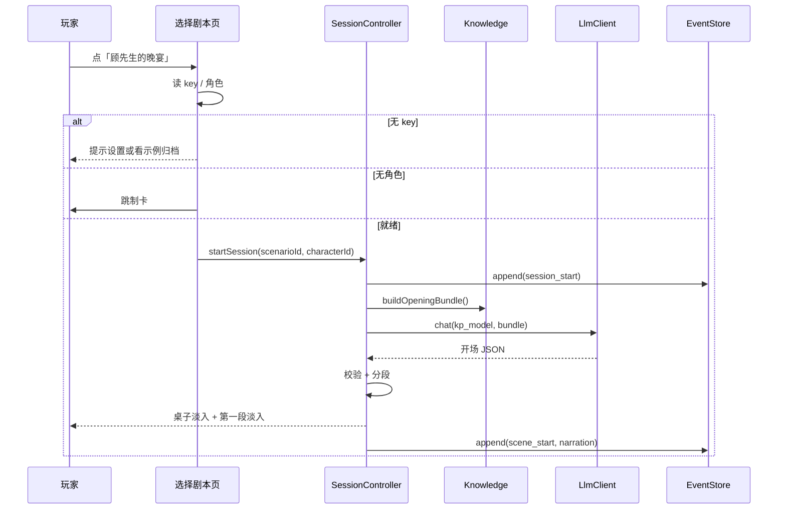

开场必须含：场景名、目标、在场人、一句画面感。**不在开场解释规则**（规则进「游戏说明」）。

### 6.2 一个 beat

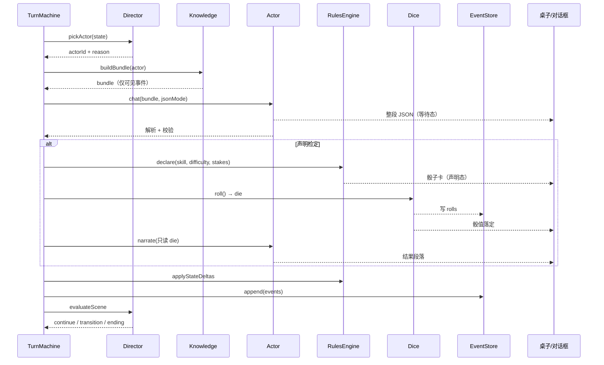

### 6.3 检定（先声明、后掷、再叙述）

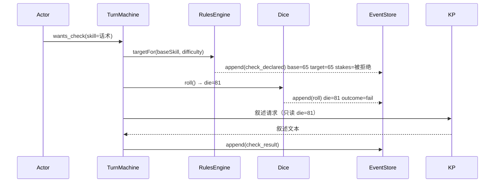

**强制手段**：叙述 prompt 的构造参数里只有 `die` 的展示值，没有生成骰值的接口；模型在文本里写「其实你掷出 20」也没用——UI 骰子卡与归档都以 `rolls` 为准。

### 6.4 插话（D-08）

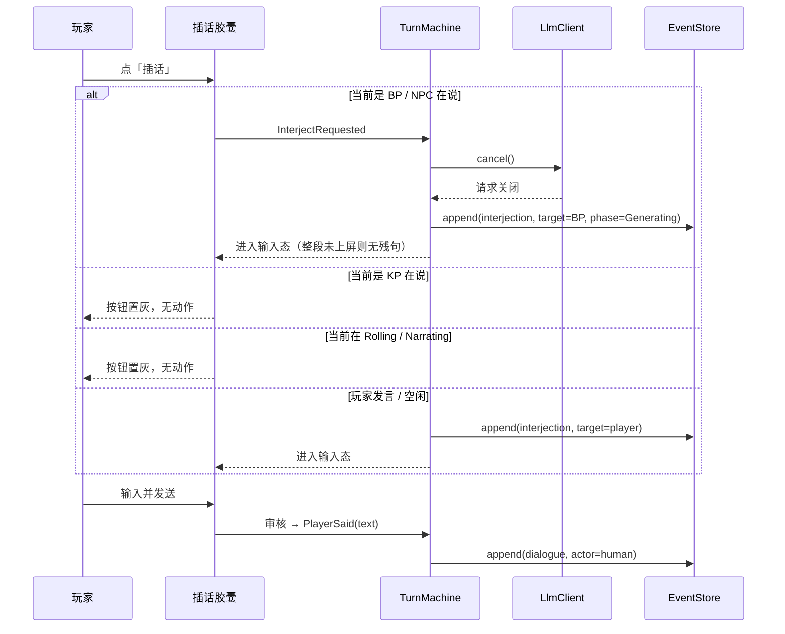

### 6.5 场景结算与转场

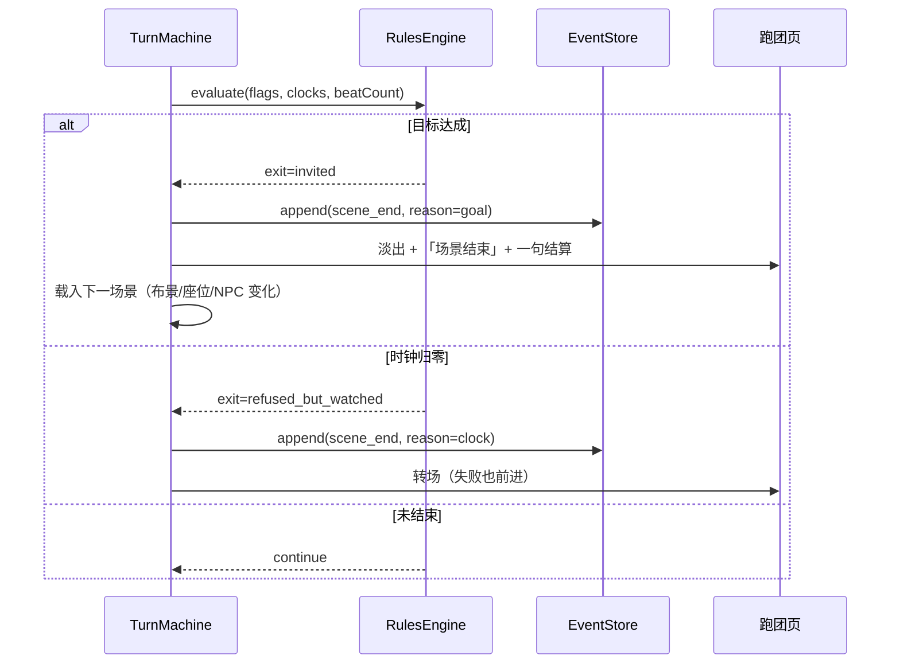

### 6.6 归档生成

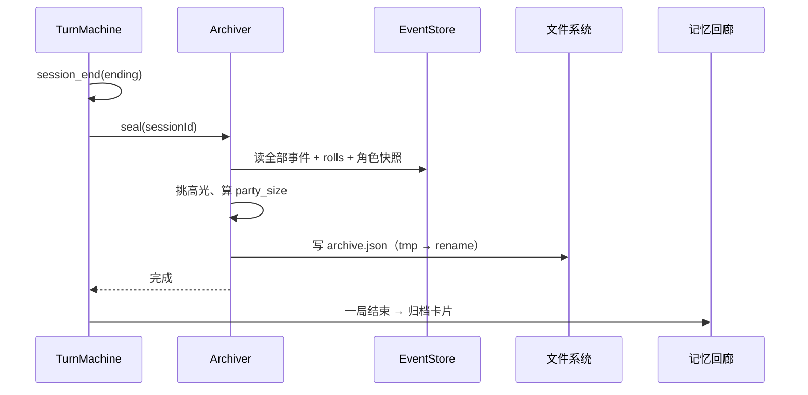

原子性：先写 `archive.json.tmp`，`fsync` 后 `rename`；崩溃最多留一个 tmp。

### 6.7 输入审核（D-28）

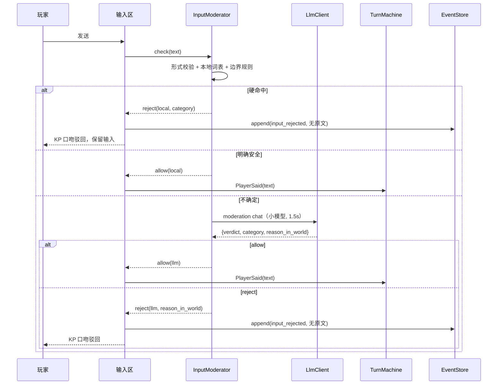

### 6.8 无 key / 断网冷启动

```
启动 → 首页 → 记忆回廊
  ├─ 本机归档可读（无需网络）
  ├─ 示例归档卡片（随包）可读
  └─ 点「选择剧本」→ 提示先设置 key → 设置页「测试连接」给出可操作原因
```

**不做**任何假对话/假骰子/假进度的演示模式。

---

## 7. 接口与契约

### 7.1 LLM HTTP 契约（OpenAI 兼容）

```
POST {base_url}/chat/completions
Authorization: Bearer {api_key}
Content-Type: application/json

{
  "model": "deepseek-chat",
  "messages": [
    { "role": "system", "content": "<identity+card+scene+rules+contract>" },
    { "role": "user",   "content": "<knowledge 窗口 + task>" }
  ],
  "response_format": { "type": "json_object" },
  "temperature": 0.85,
  "max_tokens": 700
}
```

**响应处理（dio）**：

1. 整体 60 s 超时；连接 10 s；
2. `statusCode != 200` → 按 §7.3 映射；
3. `choices[0].message.content` 取出 → `jsonDecode` → 校验器；
4. 解析失败 → **直接报错给 UI，不重试、不修复调用**（V-24）；
5. 取消：`CancelToken.cancel()`，dio 会中断连接。

**供应商差异**：`response_format` 不支持时，只在 prompt 里要求 JSON；解析失败同样直接报错，不做二次调用。

### 7.2 内部端口（Dart 抽象）

```dart
// ---- 随机与时间 ----
abstract interface class RngPort   { int nextInt(int max); }
abstract interface class ClockPort { DateTime now(); }

// ---- LLM ----
abstract interface class LlmPort {
  Future<LlmResult> chat({
    required String model,
    required List<ChatMsg> messages,
    required CancelToken token,
    double temperature,
    bool jsonMode,
  });
}

// ---- 持久化 ----
abstract interface class EventStore {
  Future<void> appendAll(String sessionId, List<GameEvent> events);
  Future<List<GameEvent>> readAll(String sessionId);
  Future<void> saveSession(SessionMeta meta);
  Future<void> sealArchive(String sessionId);
}

// ---- 平台能力（3 个）----
abstract interface class FileDirsPort { Future<Directory> appData(); Future<Directory> cache(); }
abstract interface class SettingsPort { Future<String?> read(String k); Future<void> write(String k, String v); }
abstract interface class SecretPort {
  Future<String?> read(String k);
  Future<void> write(String k, String v);
  Future<void> delete(String k);
}
```

### 7.3 错误码

| 码 | 场景 | 用户文案（短） |
|---|---|---|
| `E_NO_KEY` | 未配置 key | 先在设置里填 API key |
| `E_KEY_INVALID` | 401/403 | key 无效或已过期 |
| `E_BASE_URL` | 404/DNS | 地址不对，检查设置 |
| `E_RATE_LIMIT` | 429 | 对方忙，稍等 |
| `E_TIMEOUT` | 超时 | 网络慢，重试？ |
| `E_NET_DROP` | 网络中断 | 话没说完，重试？ |
| `E_PARSE` | JSON 解析失败（修复前） | （透明） |
| `E_PARSE_FATAL` | 修复后仍失败 | 这一句没能推进剧情 |
| `E_MODERATION` | 审核驳回 | （由 KP 台词承载，不显示码） |
| `E_MODERATION_UNAVAILABLE` | 审核服务不可用 | 现在没法判断这句话，稍后再试 |
| `E_BUDGET` | 预算超限 | 本场到此为止 |
| `E_SCENARIO` | 剧本校验失败 | 剧本文件有问题 |
| `E_STORAGE` | 写盘失败 | 存不下这一局，清理后再试 |
| `E_PLATFORM` | 端口不可用（OHOS 缺能力） | 这个功能在当前设备不可用 |

---

## 8. 非功能设计

### 8.1 延迟预算（单 beat，P95）

| 环节 | 预算 | 手段 |
|---|---|---|
| 本地规则审核 | ≤ 5 ms | 纯 Dart 词表 |
| LLM 审核（仅不确定时） | ≤ 1.5 s | 小模型、`max_tokens` 120 |
| Director 选人 | ≤ 5 ms | 纯 Dart |
| 组 bundle | ≤ 15 ms | 内存过滤 |
| LLM 生成整段 JSON | ≤ 6 s | 限 1–3 句、`max_tokens` 700、就近区域 |
| 校验 + 修复 | ≤ 1.5 s（仅失败时） | 修复用 cheap 模型 |
| 骰子卡动画 | 0.6 s（可跳过） | 与网络解耦 |
| 落盘 | ≤ 20 ms | 追加写、按 beat 批量 |
| **合计** | **≤ 10 s** | 其中审核只在模糊输入时发生 |

> 与逐字方案相比，按段显示的「首段延迟」等于整段生成时间（约 3–6 s）。这是 D-12 的代价，用「等待态 + 段落淡入」缓解：等待时对话框显示 `KP 正在斟酌……` / `Stella 正在想……`。

### 8.2 成本量级

| 项 | 量级 |
|---|---|
| 每 beat LLM 调用 | 1–2 次（有检定 2–3 次） |
| 单局 beat | 20–35 |
| 单次 prompt | 1.2k–2.5k token（BP）/ 2k–4k（KP） |
| 单次 completion | 200–500 token（JSON 比纯文本略多） |
| 审核开销 | 约 10–20% 输入触发，单次 ≤ 120 token |
| 单局成本 | 便宜模型几毛到两元；KP 用强模型一到五元 |

结论：PRD 的「单局 < ¥5」在默认配置下有富余；强模型 + 长 prompt 会顶到上限，因此保留 `E_BUDGET` 熔断。

### 8.3 隐私与安全

| 威胁 | 是否防得住 | 说明 |
|---|---|---|
| 别的 App 读 key | 基本防住 | Android Keystore / OHOS 安全存储；未 root 时进程隔离 |
| 拿到手机的人读 key | 防不住 | 单机本质限制；靠系统锁屏 |
| 备份文件泄露 key | 部分 | Keystore 内的 key 不进普通备份；OHOS 兜底 AES 方案的派生材料在本地 |
| 归档被外部读到 | 防住（默认） | 应用私有目录；且**不提供导出**（V-13） |
| 对话外发给供应商 | 无法避免 | 本来就发给 LLM；**审核请求也会带上玩家原话**，设置页必须写明 |
| 日志泄露台词 | 防住 | D-26：只记元数据，不记文本 |
| 仓库泄露对局 | 防住（制度） | 归档与日志不进仓库（V-10） |

**设置页原文（两段）**：

> 「API key 保存在本机安全存储中，不会上传到任何服务器；已 root 的设备无法保证安全。」
> 「你的对话内容会发送给所选模型服务商，其中用于安全判断的内容也会发送；归档只保存在本机，不提供导出。」

#### D-26 = A：诊断日志只记元数据

| 记 | 不记 |
|---|---|
| 时间、耗时、token 数、错误码、审核 stage/category、修复次数 | prompt 原文、台词、玩家输入原文、归档正文 |

**为什么不做「全量日志开关」**：单机、单人、换机即实测；日志传不回来，记全文只剩泄露风险。出问题时的复盘靠「事件流 + 元数据」足够定位到拍。

### 8.4 可靠性

| 场景 | 设计 |
|---|---|
| 写盘失败（空间不足） | 当场提示 `E_STORAGE`，停止本局，保留已写内容 |
| 归档写到一半 | `tmp + rename`，最多留一个 tmp |
| 双开同一局 | 会话目录放 `lock` 文件，第二个实例只读 |
| 系统时间被改 | 排序一律以 `seq` 为准，时间戳只作展示 |
| 剧本版本不一致 | session 记 `scenario_version`，不一致拒绝开局 |
| 应用被杀 | **不恢复**（V-14）：未结束的局不提供续局入口，重进即首页 |

### 8.5 可访问性

| 项 | 要求 |
|---|---|
| 字号 | 90%–200% 不破版；正文 ≥ 16 sp |
| 对比度 | 正文 ≥ 4.5:1；羊皮纸上的暗红印章单独测 |
| 点击区 | ≥ 48×48 dp；插话胶囊 56×120 dp |
| 骰子卡 | 必须有纯文本语义：`话术 目标 65 骰值 81 失败` |
| 动效 | 跟随「减少动效」：关淡入、关翻面，保留直接切换 |
| 不只靠颜色 | 成功/失败同时用印章/裂痕图形与文字 |
| 阅读顺序 | 桌子 → 对话框 → 插话 → 输入 |
| 文字呈现 | 按段整段出现天然对屏幕阅读器友好（无需等待逐字） |

### 8.6 字体与包体（D-21 = A）

- **系统字体**：标题用系统衬线（Android `serif` / OHOS 默认宋体类），正文用系统黑体；**不打包字体**。
- 代价：不同 ROM 字形略有差异；两平台的「跑团质感」主要靠木牌、羊皮纸、印章这些图与动效撑。
- 包体预算：**≤ 40 MB**（无字体、单套桌面图、示例归档 ≤ 300 KB）。
- 后期要换字体时：只加 `assets/fonts/` 与 `pubspec.yaml` 的 `fonts` 段，不动业务代码。

---

## 9. 测试与评估

### 9.1 分层

| 层 | 对象 | 工具 | 何时跑 |
|---|---|---|---|
| L1 单元 | 规则、骰子、Director、知识过滤、审核规则、JSON 校验 | `dart test`（纯 Dart） | 每次保存 |
| L2 引擎集成 | 用录制响应跑完整 beat / 整局 | `dart test` + cassette | 每次保存 |
| L3 组件/golden | 四屏、骰子卡、两档字号、两平台 | `flutter test` + golden | 提交前 / CI |
| L4 真机冒烟 | Android + OHOS：能开局、能插话、能归档 | 手动清单 | 每个里程碑 |
| L5 人工评估 | 20 局 + 指标 | 评估脚本 + 人工打分 | 收尾 |

L1/L2 必须能在无网络、无 key 的 CI 上跑——这是 D-01 选 B 的回报。

### 9.2 录制回放（替代 Mock）

```json
{ "request_hash": "…", "model": "deepseek-chat", "kind": "bp_turn",
  "response": { "speech": "您好，顾先生，我是 Stella。", "wants_check": { "skill": "话术" } },
  "recorded_at": "2026-10-21" }
```

`FakeLlmPort` 按 `request_hash` 返回预置 JSON。测试确定、不烧钱、不联网；模型升级后 cassette 会过时，所以每周手动跑一次真 LLM 冒烟（不进 PR CI）。

### 9.3 规则与骰子测试

| 测试 | 断言 |
|---|---|
| 均匀性 | 10 万次 `nextInt(100)+1`，1–100 每面频次 ±1.5% |
| 宽档边界 | 基础 80：1–5 `critical`；6–80 `success`；81–99 `fail`；100 `fumble` |
| 窄档边界 | 基础 40：1 `critical`；2–40 `success`；41–95 `fail`；96–100 `fumble` |
| 档位切换 | 基础 49 → 窄档；50 → 宽档（同一 die 评级不同） |
| 难度 | 技能 65：普通 65 / 困难 32 / 极难 13 |
| 目标来自角色卡 | 换角色卡后 target 随之变化，不读剧本数字 |
| 神话 0 | `target ≤ 0` → 恒 `fail`，die=1 也不 critical |
| 闪避派生 | 敏捷 45 → 22；敏捷 60 → 30 |
| 骰值不可被文案改变 | 模型输出写「骰出 20」时，`roll.die` 不变 |
| 派生值 | 体质 50 → HP 15；意志 55 → MP 11、SAN 55 |

### 9.4 信息边界测试

```dart
test('Stella 的 bundle 不含老陈的秘密', () {
  final bundle = Knowledge().buildBundle(bpStella, allEvents);
  final prompt = PromptBuilder.build(bundle);
  expect(prompt, isNot(contains('账本')));
  expect(prompt, isNot(contains('地下室')));
});
```

输出侧：KP/BP 输出若命中「他人秘密关键词集」，记 `E_LEAK_SUSPECT` 并计入评估（不硬拦，可能是玩家自己说出来的）。

### 9.5 审核测试

| 测试 | 断言 |
|---|---|
| 硬违规 | 违法、未成年、露骨、虐待细节 → `reject(local)`，且不进入 transcript |
| 出戏/现代梗 | 「我掏出手机打电话」→ `uncertain` → LLM 判 `reject` |
| 合法离谱 | 「我把顾先生变成鸡」→ `allow`（离谱但不出戏，这正是游戏乐趣） |
| 正常社交 | 「我邀请他赴宴」→ `allow(local)`，不触发 LLM |
| 误杀率 | 50 条正常输入，误杀 < 5% |
| 审核不可用 | 模拟超时 → `E_MODERATION_UNAVAILABLE`，不放行 |
| 隐私 | `input_rejected` 事件里不含原文 |

### 9.6 剧本 lint 与 golden

lint 必查项见 §4.12；golden 基准：四屏 × {360×780, 412×915} × {100%, 200% 字号} + 骰子卡成功/失败。

### 9.7 20 局评估（D-27 = C + B）

**玩家来源**：

- 先跑**预设动作集**（每场景 8–12 个动作，含 1 次离谱操作 + 1 次违规尝试）；
- 若当前局面完全没命中预设动作，走 **LLM 生成**玩家行动（避免脚本卡死）；
- 两种来源都记在 `run.json` 里，便于分开统计。

| 指标 | 采集 | 目标 |
|---|---|---|
| 完成率 | 20 局里跑完门廊的局数 | ≥ 16 |
| 单局时长 | 归档 `duration_minutes` | 15–20 min |
| 吐槽/局 | 事件 `intent == taunt` | ≥ 1 |
| 拒绝或善变/局 | `intent == refuse/shift` | ≥ 1 |
| 信息泄露 | §9.4 | 0 |
| 骰值一致性 | UI 骰子卡 vs `rolls` | 0 不一致 |
| 出戏 | 禁语扫描 | 0 |
| 审核拦截率 | 预设违规用例 | 100% |
| 误杀率 | 正常用例 | < 5% |
| 单 beat 延迟 | `usage.ndjson` | P95 ≤ 10 s |
| 单局成本 | 汇总 | < ¥5 |
| 主观评分 | 每局 1–5 分 | 均值 ≥ 3.5 |

产物（**不进仓库**，V-10）：

```
evaluation/2026-10-25/
├─ report.md
├─ runs/run_01/…
├─ bad_runs.md
└─ metrics.csv
```

### 9.8 平台矩阵

| 机型 | 验证点 |
|---|---|
| Android 中端机 | 冷启动、按段显示不卡、键盘弹起布局 |
| Android 低端机 | 内存峰值（桌面图）、长 transcript |
| OHOS 手机 | 网络权限、私有目录、安全存储、字体渲染、返回手势 |
| 两平台折叠屏 | 仅确认不崩、不拉伸 |

---

## 10. 工程实现

### 10.1 依赖白名单

| 依赖 | 用途 | 类型 | OHOS 风险 |
|---|---|---|---|
| `flutter_riverpod` | 状态 | 纯 Dart | 无 |
| `go_router` | 路由 | 纯 Dart | 无 |
| `yaml` | 剧本解析 | 纯 Dart | 无 |
| `dio` | HTTP + 取消 | 纯 Dart | 无 |
| `cryptography`（仅 OHOS 兜底） | AES-GCM | 纯 Dart | 无 |
| `path_provider` | 私有目录 | 插件 | 中 |
| `shared_preferences` | 设置 | 插件 | 中 |
| `flutter_secure_storage` | 密钥 | 插件 | 高（OHOS 需验证） |

**插件合计 ≤ 3**；`cryptography` 是纯 Dart，不算插件。已删除：`image_picker`、`audioplayers`、`sqlite3_flutter_libs`、`drift`。

### 10.2 代码骨架（最小可运行集）

| # | 文件 | 职责 | 完成标志 |
|---|---|---|---|
| 1 | `engine/rules/character_rules.dart` | 属性/技能/派生常量 | 单测全绿 |
| 2 | `engine/rules/check.dart` | 目标与评级（两档） | 边界测试通过 |
| 3 | `engine/dice/dice.dart` | `rollDie` | 均匀性通过 |
| 4 | `engine/turn/turn_machine.dart` | `reduce` | 用假事件跑完一拍 |
| 5 | `engine/director/director.dart` | 选人与轮次 | 轮次测试通过 |
| 6 | `engine/knowledge/filter.dart` | 可见性 | 泄漏测试通过 |
| 7 | `engine/moderation/local_rules.dart` | 本地审核 | 用例集通过 |
| 8 | `scenario/schema.dart` + lint | 剧本模型 | `scenario_lint` 通过 |
| 9 | `llm/client.dart` | dio + JSON 校验 + 修复 | 录制回放通过 |
| 10 | `engine/archive/sealer.dart` | 归档生成 | 能被记录页渲染 |
| 11 | `app/app/di.dart` + `main.dart` | `ProviderScope` 装配所有 Port | `flutter run` 出首页 |
| 12 | `app/features/table/*` | 桌子 + 对话框 + 插话 | 能跑完门廊 |

**先写 1–10（纯 Dart），再写 UI**：第 10 步完成时，`tool/evaluate.dart` 已经能跑完整局——界面还没做，游戏已经能证明好玩。

### 10.3 构建与平台注意

**Android**

- `INTERNET` 权限；
- `minSdk 24`；
- 签名：本地 `key.properties`（不进仓库）；
- 产物：`flutter build apk --release`。

**OHOS**

- `ohos/entry/src/main/module.json5` 加 `ohos.permission.INTERNET`——**忘这一步所有请求静默失败**；
- 先确认能出 HAP，再做业务；
- 签名 profile 与设备白名单提前确认。

**两平台共同的坑**

| 坑 | 规避 |
|---|---|
| 明文流量被拒 | 只用 HTTPS |
| 大图内存溢出 | 桌面图按屏宽解码（`cacheWidth`） |
| 键盘遮挡 | `resizeToAvoidBottomInset` + 滚动到可见 |
| 安全存储在 OHOS 不可用 | 条件导入走 AES 兜底（§4.8） |

### 10.4 CI（要点）

- job 1：`dart analyze` + `dart test` + `flutter test` + golden；
- job 2（手动）：真 LLM 冒烟 1 局；
- job 3（可选）：`flutter build apk --debug` 编译通过；
- OHOS 构建不进公共 CI，按里程碑手动出包。

---

## 11. 风险登记册

| # | 风险 | 概率 | 影响 | 对策 | 早期信号 |
|---|---|---|---|---|---|
| R1 | OHOS 上安全存储/目录不可用 | 高 | 中 | 插件 ≤3 + 兜底；先跑探针 App | 探针第一天失败 |
| R2 | JSON 输出不守 schema，修复率高 | 中 | 高 | 强 contract + 正例；校验器 + 修复；把修复率做成指标 | 修复率 > 15% |
| R3 | AI 互相客气、冷场 | 高 | 高 | 目标/秘密/关系进卡；轮次硬规则；限 beat | 连续 2 局无冲突 |
| R4 | 吐槽变冒犯 / 出戏 | 中 | 中 | 禁语校验 + 只吐槽行为 + 评估记录 | 出现人身攻击 |
| R5 | 单 beat 超过 10 s | 中 | 中 | 缩 prompt、限句数、KP/BP 分模型 | P95 连续 3 局超 |
| R6 | 审核误杀正常输入 | 中 | 高 | 本地规则只拦硬项；模糊交 LLM；误杀率进评估 | 自玩时被驳回 |
| R7 | 审核服务不可用导致玩不了 | 中 | 中 | fail-closed + 明确重试；词表随时扩容 | 玩家卡在等待 |
| R8 | 范围膨胀（想做第二剧本/编辑器） | 高 | 高 | §13 阶段门；新想法进 backlog | 连续 3 天做范围外 |
| R9 | 包体超预算 | 低 | 低 | 不打包字体、单套桌面图 | > 40 MB |

---

## 12. 决策台账（回填）

| ID | 决策点 | 结论 |
|---|---|---|
| D-01 | 工程结构 | B：`engine` 纯 Dart + Flutter 壳 |
| D-02 | 平台适配 | A：条件导入 |
| D-03 | 编排执行模型 | A：纯状态机 + 效果 |
| D-04 | 行动者选择 | A：纯规则打分 |
| D-05 | 检定目标 | 角色技能值 |
| D-06 | 骰子 | 本地随机 + 先落库 |
| D-07 | 知识边界 | A：可见性过滤（备选保留） |
| D-08 | 插话窗口 | C′：BP/NPC 可打断；KP 与骰子不可 |
| **D-09** | **状态管理** | A：Riverpod |
| D-10 | 路由 | A：`go_router` |
| D-11 | 桌子渲染 | B + A：位图 + Canvas |
| D-12 | 文本呈现 | D：按段显示 |
| D-13 | 动效 | A：极简，无音效 |
| D-14 | 密钥 | A：平台原生安全存储 |
| D-15 | LLM 客户端 | B：`dio` |
| D-16 | 供应商 | A + C：DeepSeek 预设 + 通用 |
| D-17 | 结构化输出 | A：JSON 模式 |
| D-18 | 上下文 | A：滑窗 |
| D-19 | 剧本格式 | A：YAML |
| D-20 | 剧本分发 | A：随包 |
| D-21 | 字体 | A：系统字体 |
| D-22 | 本地存储 | D：纯文件 |
| D-23 | 归档模型 | A：全量事件 |
| D-24 | 导出 | D：不导出 |
| D-25 | 示例归档 | A：随包只读 |
| D-26 | 日志 | A：只记元数据 |
| D-27 | 评估玩家 | C + B：预设动作 + LLM 兜底 |
| D-28 | 输入审核 | B：本地规则 + LLM 兜底 |

---

## 13. 工程阶段声明

> 本文件正文（§1–§12）不含任何分期标记；**阶段划分只在此处声明一次**，与 [PRD 06 §4 里程碑](../PRD/06_归档与作品化.md) 对齐。

| 阶段 | 对应 PRD | 范围（模块） | 前置条件 | 出口标准 |
|---|---|---|---|---|
| **P0 · 能玩一局** | M0–M1 | §3 全部内核；§4.1–§4.8 四屏；§5 数据与归档；§7 契约 | 无（决策已全部落定） | 真机跑完门廊 15–20 分钟；1 次检定、1 次失败、1 次吐槽、1 次插话；自动生成归档；审核能拦违规输入 |
| **P1 · 好玩 + 能展示** | M2–M3 | §4.9–§4.12；§5.4 完整归档；§9.5–§9.7；§10.4 | 无 | 2 BP + 拒绝/善变稳定出现；20 局评估报告；示例归档可离线读；README/架构图/Demo 就绪 |
| **P2 · 扩展** | 里程碑之后 | 第二场景与三幕；§3.5 的 B/C 记忆升级 | 由你另行立项目标 | 本文件不承诺时间 |

**阶段门规则**：

1. 上一阶段出口未达成，不进入下一阶段；
2. 决策已全部落定，因此**默认不再阻塞**；若实现中暴露新决策点，新增 D 编号并暂停该模块；
3. 阶段内新增需求进 backlog，不插队；
4. 每次阶段结束回填 §12 并升版本号。

### 当前实现进度（2026-10-21 · M2）

| 模块 | 状态 | 证据 |
|---|---|---|
| `engine/rules`（属性/技能/角色卡/检定两档） | ✅ | 单测覆盖边界、档位切换、预算、派生 |
| `engine/dice` | ✅ | 映射与均匀性测试 |
| `engine/director` | ✅ | 轮次硬规则、补位、0 BP 退化 |
| `engine/knowledge` | ✅ | 泄漏断言（Stella 看不到老陈的秘密） |
| `engine/moderation`（本地规则） | ✅ | 8 类用例 + 误杀防护 |
| `engine/scenario`（YAML + lint） | ✅ | 门廊可解析、lint 零 error |
| `engine/turn`（状态机 + 效果） | ✅ | 完整一拍、插话窗口、乱序忽略 |
| `engine/store`（NDJSON 事件） | ✅ | 追加写、损坏行丢弃、会话枚举 |
| `engine/archive`（归档生成） | ✅ | 生成/列表/读回/高光挑选 |
| `llm/client`（dio + JSON） | ✅ | 错误码映射、fence 解析；未接真机 key |
| `llm/prompts` + `llm/schema` | ✅ | BP/KP/骰后/审核 prompt；禁语与技能校验 |
| 会话编排（选人→LLM→检定→掷骰→叙述→落盘） | ✅ | `TableNotifier`，含插话取消与一次修复 |
| 跑团页 / 记录页 / 记忆回廊 | ✅ | 真实状态、骰子卡、归档列表与回看 |
| 首页状态化（API/角色） | ✅ | 两个状态胶囊 + 烛光背景 |
| 输入审核的 LLM 兜底 | ✅ | 已在 `TableNotifier._moderateWithLlm` 接入 |
| 真机联调（真实 API key） | ⬜ | 需要你的 key 与设备 |
| 场景结算 / 多结局 / 20 局评估 | ⬜ | 下一阶段 |

**验证现状**：`flutter analyze` 无问题；`flutter test` **95 个测试全绿**；`flutter build web --release` 通过。Android 构建仍受限于本机未装 Android SDK。

---

**文档状态**：v0.7 · 28 项决策全部已定 · 10 项口径已确认 · 18 项偏差已登记 · P0 接近完成（待真机联调）
**维护约定**：决策一旦落定即删除备选（D-07 例外）；架构级改动新增 D 编号，不覆盖旧编号。

